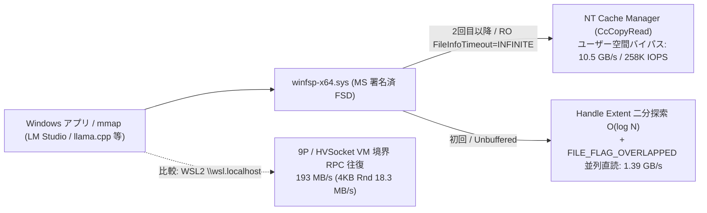

# ZeroExt4

**Language:** [English](README.md) | 日本語

Windows 11 / 10 向けの **`libext2fs` (`e2fsprogs`) + `WinFsp`** ベース高速 ext2 / ext3 / ext4 ユーザー空間ファイルシステムドライバ、管理 CLI ツール（`zeroext4.exe`）、およびデスクトップ GUI マウントマネージャー（`ZeroExt4Gui.exe`）です。

> **なぜ作ったのか**: Linux パーティション上に置いた巨大な AI モデル（GGUF / Safetensors 等）や開発データを **複製せず・ext4 を壊さず・BSOD リスクゼロのユーザー空間動作のまま、Windows Native NTFS 並みの速度で共有する** ために設計されています。

## 他手法との違い・実測ハイライト

| 方式 | マウント形態 | Warm 読取 (`1MB` / `4KB Rnd`) | Cold 実 SSD (`1MB`) | 現代 ext4 対応 | BSOD リスク | 非破壊書込 |
| :--- | :---: | :---: | :---: | :---: | :---: | :---: |
| **`ZeroExt4` (既定 RO / DIO)** | **◎ (`L:` 等)** | **`10,536` / `1,008 MB/s`**<br><sub>(`Native NTFS` 比 `1.03x〜1.07x`)</sub> | **`1,386 MB/s`** | **◎ (`libext2fs`)** | **ゼロ** | **◎ (`--overlay`)** |
| **WSL2 (`wsl --mount` + 9P)** | △ (`\\wsl.localhost`) | `193` / `18.3 MB/s`<br><sub>(`ZeroExt4` 比 `1/55〜1/70`)</sub> | `127 MB/s` | ◎ | 低（VM 要） | × |
| **旧来のカーネル FSD (`Ext2Fsd` 等)** | ◎ | 高速 | 高速 | △〜× | **高** | × |
| **商用ドライバ / 読取ビューア** | ◎ / × | 高速 / 複製要 | 高速 / 複製要 | ◎ / ○ | 中 / ゼロ | × |

### 速さのしくみ（2-Tier I/O バイパス）



- 他手法との詳細比較・シーケンス図・ベンチマーク条件は **[技術概要・他手法比較・ユースケース](docs/overview.md)** および **[性能評価レポート](docs/reports/performance-evaluation.md)** を参照してください。

## 主なユースケース

- **デュアルブートでの巨大 AI モデル共有**: Linux 側 ext4 に配置した 10〜100 GB 級の GGUF / Safetensors を Windows 側の LM Studio / `llama.cpp` / ComfyUI から複製なしで高速 `mmap` 読込（`--overlay` で設定・キャッシュ書込も Linux 側を汚さず分離）。
- **ML データセット / 動画・3D アセット共有**: 大量ファイルを含むフォルダも 16 シャード正/負 Dentry キャッシュと `FspGetDirInfoByName` により軽快に走査・共有。
- **Linux 外付け NVMe / microSD 保守・救出**: Raspberry Pi / Jetson / Steam Deck / Linux サーバーのディスクを接続し、Dirty Journal 検査＋Read-Only マウントで安全に救出。
- **組込み・VM イメージ (`.img`) の非破壊検証**: `--overlay` で差分だけ NTFS 上に保持しつつ動作確認（WinFsp なし環境では GUI / CLI のオフライン閲覧も利用可）。
- **停止済み WSL2 (`ext4.vhdx`) の高速検索**: `\\wsl.localhost`（`18.3 MB/s`）を回避し、ネイティブツールから最大 55 倍以上のランダム 4KB 応答で参照可能。

具体的なコマンド例や注意点は [docs/overview.md](docs/overview.md#3-実践ユースケース) を参照してください。

## 主な特徴

- **本家 `e2fsprogs` (`libext2fs` `1.47.4`) 採用**: 64bit ブロック番号、ext4 エクステント (`EXT4_EXTENTS_FL`)、256B+ iノード（ナノ秒タイムスタンプ・`crtime`）、`metadata_csum` (CRC32C)、HTree ディレクトリ、および WinFsp Reparse Point シンボリックリンク（`IO_REPARSE_TAG_SYMLINK`）に対応。
- **2-Tier 高速・安全 WinFsp パイプライン**: Read-Only 時は既定 `FileInfoTimeout = INFINITE` で Windows NT Cache Manager (`CcCopyRead` / `Mm`) と協調し、`PassQueryDirectoryFileName = 1`・`FspGetDirInfoByName`・早期 `Marker` スキップ・統合 Open/Write Stat でメタデータ経路も高速化。
- **ダイレクト・エクステント I/O エンジン（RO / Overlay 時既定有効、`--no-direct-io` で無効化可）**: オープンハンドル `cached_extents` と 16 シャード `extent_cache` を用い、`O(log N)` 二分探索＋ロックレス物理セクタ直読 (`win32_io_pread_direct`) を実行（`--rw` 時は自動無効）。
- **非破壊 NTFS Overlay マウント (`--overlay`)**: Lower ext4 を厳密 Read-Only に保ったまま NTFS フォルダへ Copy-up・新規作成・Whiteout 削除（`.wh.*`）を逃がし、O(1) ハッシュマップ、v2 `.wh.__ext4_lower_id` 検証、`--case-sensitive`（`FileCaseSensitiveInfo`）、POSIX 所有者／パーミッション設定（`--uid`/`--gid`/`--inherit-owner`/`--fmode`/`--dmode`）、および `overlay <status|diff|validate|export|reset>` 管理ツールに対応。
- **Windows ネイティブ非同期 I/O・診断・多層セーフティ**: `FILE_FLAG_OVERLAPPED`＋FLS イベント再利用で `FileObject->Lock` 直列化を解消し、4KB RMW、GPT/MBR/EBR 境界ガード、Dirty Journal／未対応機能（`encrypt`/`verity`/外部ジャーナル）検出時の RW 抑止（`--ro-fallback`）、Windows 予約名 (`CON`/`NUL` 等) ガード、非破壊 `fsck-lite`・`doctor` 診断、安全な `unmount` ターゲット検証を搭載。
- **Perfetto トレース (`--trace`) & Zero-Patch `e2fsprogs`**: 無効時ゼロオーバーヘッドで [Perfetto UI](https://ui.perfetto.dev/) 形式を出力でき、MSVC 互換シムは `compat/` へ分離。

## クイックスタート

### 1. ビルドとテスト

Windows 環境で **Visual Studio 2022**・**Python 3.x**・（任意で **.NET 10 SDK**）を用意して実行します（ビルド時 WinFsp SDK 不要）：

```powershell
powershell -ExecutionPolicy Bypass -File .\scripts\build_and_test.ps1
```

GUI 単体ビルド（`build_gui.ps1`）、ASan / CRT リーク検出 / `/analyze`（`run_sanitizers.ps1`）、および `e2fsprogs` 更新手順は [開発・ビルド・保守ガイド](docs/guides/development.md) と [テスト・検証ガイド](docs/testing.md) を参照してください。

### 2. WinFsp のインストール（ドライブマウント時に必須）

オフライン検査・操作コマンドや GUI ファイルブラウザは WinFsp 不要ですが、ドライブマウントには **WinFsp** ランタイム（`Core`）が必要です：

```powershell
winget install WinFsp.WinFsp
```

Chocolatey / 公式 `.msi` による導入や確認コマンドは [利用ガイド §1](docs/guides/usage.md#1-winfsp-ランタイムのインストール) を参照してください。

### 3. GUI 起動または CLI マウント

- **デスクトップ GUI (`.\build\gui\ZeroExt4Gui.exe`)**: 物理ディスク／`.img` の自動検出と JBD2 状態確認、WinFsp 不要のファイルブラウザ（`Mode`・`UID:GID` 表示含む）、RO / Overlay / RW マウント切替（`L:` 優先、`--case-sensitive`、POSIX `--uid`/`--gid`/`--fmode`/`--dmode` 設定、日英切替、ライト／ダークテーマ）、トレイ常駐に対応し、GPLv2 コードを直接リンクせず `zeroext4.exe` を JSON / Named Event IPC で制御します。
- **CLI 使用例**:

```powershell
# ディスク / イメージ検査と Read-Only + Direct Extent I/O マウント（既定）
zeroext4.exe list
zeroext4.exe inspect test.img
zeroext4.exe mount --source \\.\PhysicalDrive2 --partition 2 --mountpoint L:

# 非破壊 Overlay マウント（Lower ext4 は RO 保護・変更だけ NTFS フォルダへ保存）
zeroext4.exe mount --source \\.\PhysicalDrive2 --partition 2 --mountpoint L: --overlay D:\ext4_upper

# Direct Read-Write マウント（既定 e2fsprogs 準拠、高速バッチは --rw-fast-io を併用）と安全なアンマウント
zeroext4.exe mount --source \\.\PhysicalDrive2 --partition 2 --mountpoint L: --rw
zeroext4.exe unmount L:
```

GUI 詳細・オフライン操作（`mkfs` / `ls` / `cat` / `write`）・全 CLI オプションは [利用ガイド](docs/guides/usage.md) を参照してください。

> [!WARNING]
> **`--rw` モード利用時のデータ破壊リスク**: 直接 Read-Write (`--rw`) は JBD2 トランザクションジャーナリングによるクラッシュ耐性を持たず、`libext2fs` 経由で ext4 のメタデータおよびデータブロックを直接書き換えます。書込中の強制終了・電源断・クラッシュや予期しない不具合により ext4 ファイルシステムが破損するリスクがあるため、重要なデータは事前にバックアップするか、下位 ext4 を厳密 Read-Only に保つ `--overlay` モードを優先して利用してください。

## ドキュメント

- **[ドキュメント一覧 (`docs/README.md`)](docs/README.md)**
- **[技術概要・他手法比較・ユースケース](docs/overview.md)**
- [要件定義書](docs/requirements.md)
- [アーキテクチャ設計書](docs/architecture.md)
- [Architecture Decision Records (ADR)](docs/adr/README.md)
- [詳細設計書](docs/design/detailed-design.md)
- [利用ガイド](docs/guides/usage.md)
- [開発・ビルド・保守ガイド](docs/guides/development.md)
- [テスト・検証ガイド](docs/testing.md)
- [性能評価レポート](docs/reports/performance-evaluation.md)
- [Perfetto トレース解析・最適化レポート](docs/reports/perfetto-trace-analysis.md)
- [Ext4Windows との技術比較分析](docs/reports/ext4windows-comparison.md)
- [ロードマップ](docs/roadmap.md)
- [変更履歴](CHANGELOG.md)
- [コントリビューションガイド](CONTRIBUTING.md)

## ライセンス

本プロジェクトは `e2fsprogs` (`libext2fs`) に基づくため **GNU General Public License v2.0 (GPLv2)** の下で提供されます。詳細は [LICENSE](LICENSE) およびサードパーティ表記 ([THIRD_PARTY_NOTICES.md](THIRD_PARTY_NOTICES.md)) を参照してください。
