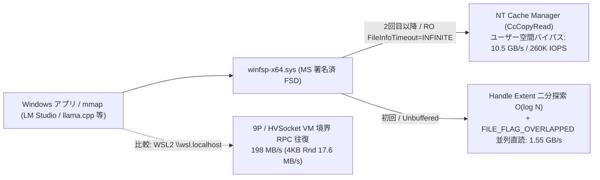

# `ZeroExt` (`zeroext`)

Windows 11 / 10 向けの **`libext2fs` (`e2fsprogs`) + `WinFsp`** ベース高速 ext2 / ext3 / ext4 ユーザー空間ファイルシステムドライバ、管理 CLI ツール（`zeroext.exe`）、およびデスクトップ GUI マウントマネージャー（`ZeroExtGui.exe`）です。

> **なぜ作ったのか**: Linux パーティション上に置いた巨大な AI モデル（GGUF / Safetensors 等）や開発データを **複製せず・ext4 を壊さず・BSOD リスクゼロのユーザー空間動作のまま、Windows Native NTFS 並みの速度で共有する** ために設計されています。

## 他手法との違い・実測ハイライト

| 方式 | マウント形態 | Warm 読取 (`1MB` / `4KB Rnd`) | Cold 実 SSD (`1MB`) | 現代 ext4 対応 | BSOD リスク | 非破壊書込 |
| :--- | :---: | :---: | :---: | :---: | :---: | :---: |
| **`ZeroExt` (既定 RO / DIO)** | **◎ (`M:` 等)** | **`10,524` / `1,017 MB/s`**<br><sub>(`Native NTFS` 比 `1.01x〜1.04x`)</sub> | **`1,551 MB/s`** | **◎ (`libext2fs`)** | **ゼロ** | **◎ (`--overlay`)** |
| **WSL2 (`wsl --mount` + 9P)** | △ (`\\wsl.localhost`) | `198` / `17.6 MB/s`<br><sub>(`ZeroExt` 比 `1/53〜1/69`)</sub> | `168 MB/s` | ◎ | 低（VM 要） | × |
| **旧来のカーネル FSD (`Ext2Fsd` 等)** | ◎ | 高速 | 高速 | △〜× | **高** | × |
| **商用ドライバ / 読取ビューア** | ◎ / × | 高速 / 複製要 | 高速 / 複製要 | ◎ / ○ | 中 / ゼロ | × |

### 速さのしくみ（2-Tier I/O バイパス）



- 技術的な目新しさ・詳細シーケンス比較・全ベンチマーク解説は **[ZeroExt 技術解説・既存手法比較・ユースケースガイド](docs/why_zeroext.md)** および **[性能評価報告書](docs/performance_evaluation.md)** を参照してください。

## 主なユースケース

- **デュアルブートでの巨大 AI モデル共有**: Linux 側 ext4 に配置した 10〜100 GB 級の GGUF / Safetensors を Windows 側の LM Studio / `llama.cpp` / ComfyUI から複製なしで高速 `mmap` 読込（`--overlay` で設定・キャッシュ書込も Linux 側を汚さず分離）。
- **ML データセット / 動画・3D アセット共有**: 大量ファイルを含むフォルダも 16 シャード正/負 Dentry キャッシュと `FspGetDirInfoByName` により軽快に走査・共有。
- **Linux 外付け NVMe / microSD 保守・救出**: Raspberry Pi / Jetson / Steam Deck / Linux サーバーのディスクを接続し、Dirty Journal 検査＋Read-Only マウントで安全に救出。
- **組込み・VM イメージ (`.img`) の非破壊検証**: `--overlay` で差分だけ NTFS 上に保持しつつ動作確認（WinFsp なし環境では GUI / CLI のオフライン閲覧も利用可）。
- **停止済み WSL2 (`ext4.vhdx`) の高速検索**: `\\wsl.localhost`（`17.6 MB/s`）を回避し、ネイティブツールから最大 57 倍以上のランダム応答で参照可能。

各ユースケースの具体的なコマンド例や注意点は [docs/why_zeroext.md](docs/why_zeroext.md#3-有効に利用できる実践ユースケース) を参照してください。

## 特徴

- **本家 `e2fsprogs` (`libext2fs`) 採用**: 64bit ブロック番号、ext4 エクステント (`EXT4_EXTENTS_FL`)、256B+ iノード（ナノ秒タイムスタンプ・`crtime`）、`metadata_csum` (CRC32C)、HTree ディレクトリに対応。
- **2-Tier 高速・安全 WinFsp I/O パイプライン**: Read-Only マウント時は既定で `FileInfoTimeout = INFINITE` により Windows NT Cache Manager (`CcCopyRead`) / Memory Manager (`Mm`) と完全協調（`--file-info-timeout` で変更可）。`PassQueryDirectoryFileName = 1`＋`FspGetDirInfoByName`＋早期 `Marker` スキップ＋統合 Open/Write Stat によりメタデータ経路も高速化。
- **ダイレクト・エクステント I/O エンジン（RO / Overlay 時既定有効、`--no-direct-io` で無効化可）**: 開いたファイルハンドル (`ext4_file_handle_t`) および 16 シャード Shared ロック式 `extent_cache` にエクステントマップを保持し、`O(log N)` 二分探索＋ロックレス物理セクタ直読 (`win32_io_pread_direct`) を実行（`--rw` モードでは整合性維持のため自動的に無効化）。
- **非破壊 NTFS Overlay マウント (`--overlay`)**: Lower 側の ext4 を厳密 Read-Only に保ったまま NTFS ディレクトリを上層に重ね合わせ、Copy-up 書込・新規作成・ホワイトアウト削除を透過的に実現（`.wh.__ext4_lower_id` による別 Lower 誤流用ガード付き）。
- **Windows ネイティブ非同期 I/O マネージャ (`win32_io_manager`)**:
  - `CreateFileW(FILE_FLAG_OVERLAPPED)`＋`FILE_SKIP_SET_EVENT_ON_HANDLE`＋FLS イベント再利用による真の並列非同期 I/O（`FileObject->Lock` 直列化を解消）
  - 4KB セクタ境界の自動 Read-Modify-Write (RMW) と GPT / MBR / EBR パーティション境界ガード
  - 32 シャード（64B 整列・`SRWLOCK` Shared 参照・CLOCK インプレース置換）ブロックキャッシュ＋16 シャード（世代エポック一括無効化付き）正／負 Dentry キャッシュ
- **Dirty Journal 安全保護**: マウント前に `EXT3_FEATURE_INCOMPAT_RECOVER` / `EXT2_ERROR_FS` / JBD2 スーパーブロック (`s_start != 0`) を検査し、未再生ジャーナルが残るボリュームへの不用意な RW マウントを自動抑止（または Read-Only 自動フォールバック）。
- **Perfetto 性能トレース出力 (`--trace`)**: 通常時は単一分岐によるゼロオーバーヘッドを維持しつつ、`--trace <output.json>` 指定時のみスレッドローカルリングバッファ（ロックレス記録・`QueryPerformanceCounter` 精度）へ WinFsp コールバック、`SRWLOCK` 待ち／保持時間、Extent／LRU キャッシュヒット、Direct I/O、`ReadFile`/`WriteFile`、Overlay Copy-up/Whiteout を記録し、[Perfetto UI](https://ui.perfetto.dev/) でタイムライン可視化が可能。
- **Zero-Patch `e2fsprogs` 追従構造**: `third_party/e2fsprogs` への Windows 固有ハックを排除し、`compat/` と `scripts/generate_e2fsprogs_headers.py` へ分離。

## ドキュメント

- **[技術解説・既存手法比較・実践ユースケースガイド (`why_zeroext.md`)](docs/why_zeroext.md)**
- [要件定義書](docs/requirements.md)
- [アーキテクチャ設計書・ADR (設計判断記録)](docs/architecture.md)
- [詳細設計書](docs/detailed_design.md)
- [テスト報告書・利用ガイド](docs/testing_and_usage.md)
- [性能評価報告書 (`--direct-io` / NTFS / WSL2 比較)](docs/performance_evaluation.md)
- [Perfetto トレース定量解析・性能改善計画](docs/perfetto_trace_analysis.md)
- [今後の構想・ロードマップ](docs/future_roadmap.md)

## ビルドとテスト

Visual Studio 2022 BuildTools 環境で以下を実行します（ビルド時に WinFsp SDK の事前導入は不要です。`.NET 10 SDK` が導入されている環境では GUI アプリ `ZeroExtGui.exe` も自動ビルド・テストされます）：

```powershell
powershell -ExecutionPolicy Bypass -File .\scripts\build_and_test.ps1
```

GUI のみをビルド・テストする場合は以下を実行します：

```powershell
powershell -ExecutionPolicy Bypass -File .\scripts\build_gui.ps1
```

メモリ破壊・メモリリーク・排他競合（ASan / CRT リーク検出 / `/analyze` 静的解析）をまとめて検証する場合は以下を実行します：

```powershell
powershell -ExecutionPolicy Bypass -File .\scripts\run_sanitizers.ps1
```

ビルド完了後は `.\build\gui\ZeroExtGui.exe` から GUI マウントマネージャーを起動できます。

## GUI アプリケーション (`ZeroExtGui.exe`)

- **ディスク／イメージ自動一覧 & 状態検査**: 物理ディスク（非管理者時は 1 クリックで「管理者権限で再起動」）および `.img` ファイル（ドラッグ＆ドロップ対応）の GPT / MBR / EBR パーティション・ラベル・UUID・使用率・JBD2 ジャーナル状態（`CLEAN` / `NEEDS_RECOVERY` / `HAS_ERRORS`）を可視化。
- **3 つのマウントモード選択**:
  - **Read-Only（推奨・既定）**: Direct I/O 有効で高速・安全に読取。
  - **Overlay（非破壊 RW）**: Lower ext4 を RO 保護し、変更・新規作成だけ指定の NTFS Upperdir へ保存（`.wh.__ext4_lower_id` の事前検証付き）。
  - **Read-Write**: Dirty 状態検出時の自動 RO フォールバック設定（`--ro-fallback`）に対応。
- **リアルタイム統計・システムトレイ常駐**: 読取／書込速度・累計転送量のリアルタイム表示、「エクスプローラーで開く」、安全なワンクリック・アンマウント、システムトレイ常駐、および CLI コマンドプレビュー。
- **WinFsp 不要のオフライン機能**: WinFsp 未導入環境でも、ext2/3/4 イメージ内のフォルダ・ファイル閲覧（`ファイルブラウザ` タブ）や新規 `.img` 作成（`mkfs`）、WinFsp 導入ガイド表示を利用可能。
- **疎結合アーキテクチャ**: GPLv2 の `libext2fs` / `zeroext_core` を直接リンクせず、`zeroext.exe` をサブプロセス（JSON / Named Event IPC）として制御します。

## WinFsp のインストール（ドライブマウント実行時に必須）

`zeroext.exe mount` を使用して Windows ドライブレター（例: `M:`）へマウントするには、事前に **WinFsp** ランタイムをインストールする必要があります（オフラインコマンド `list` / `inspect` / `mkfs` / `ls` / `cat` / `write` 等は WinFsp なしでも動作します）。

以下のいずれかの方法でインストールしてください：

- **winget を使用する場合（推奨）**:
  ```powershell
  winget install WinFsp.WinFsp
  ```
- **Chocolatey を使用する場合**:
  ```powershell
  choco install winfsp
  ```
- **公式インストーラ（`.msi`）を使用する場合**:
  1. [WinFsp 公式サイト](https://winfsp.dev/) または [GitHub Releases](https://github.com/winfsp/winfsp/releases) から最新の `winfsp-*.msi` をダウンロードして実行します。
  2. セットアップ種別は既定の **Core** のみで動作します（実行時に `C:\Program Files (x86)\WinFsp\bin\winfsp-x64.dll` を自動検出・動的ロードします）。

詳細なビルド手順・テスト結果・CLI リファレンスは [docs/testing_and_usage.md](docs/testing_and_usage.md) を参照してください。

## CLI 使用例

```powershell
# ディスク / パーティション一覧と状態検査
zeroext.exe list
zeroext.exe inspect test.img

# クリーンな ext4 イメージ作成・操作
zeroext.exe mkfs test.img --size-mb 64 --label MYEXT4
zeroext.exe mkdir test.img /data
zeroext.exe write test.img /data/hello.txt "Hello from ZeroExt!"
zeroext.exe ls test.img /data
zeroext.exe cat test.img /data/hello.txt
zeroext.exe extents test.img /data/hello.txt

# WinFsp で Windows ドライブへマウント (WinFsp ランタイム要・既定は Read-Only + ダイレクトエクステント直読 ON)
zeroext.exe mount --source \\.\PhysicalDrive2 --partition 2 --mountpoint M:

# Direct I/O を明示的に無効化して標準 LRU キャッシュ経由でマウント
zeroext.exe mount --source \\.\PhysicalDrive2 --partition 2 --mountpoint M: --no-direct-io

# Read-Write マウント（明示的に --rw を指定・Direct I/O は自動無効）
zeroext.exe mount --source \\.\PhysicalDrive2 --partition 2 --mountpoint M: --rw

# ext4 は Read-Only + 直読 (既定 ON) に保ち、書き込みだけ Windows NTFS フォルダへ逃がす Overlay マウント
zeroext.exe mount --source \\.\PhysicalDrive2 --partition 2 --mountpoint M: --overlay D:\ext4_upper
```

## ライセンス

本プロジェクトは `e2fsprogs` (`libext2fs`) に基づくため **GNU General Public License v2.0 (GPLv2)** の下で提供されます。詳細は [LICENSE](LICENSE) を参照してください。
