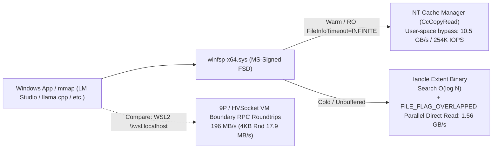

# ZeroExt4

**Language:** English | [日本語](README.ja.md)

A high-performance **ext2 / ext3 / ext4** user-space filesystem driver, CLI tool (`zeroext4.exe`), and desktop GUI mount manager (`ZeroExt4Gui.exe`) for Windows 11 / 10, built on upstream **`libext2fs` (`e2fsprogs`) + `WinFsp`**.

> **Why ZeroExt4?** Share large AI models (GGUF / Safetensors, etc.) and datasets on Linux partitions **directly with Windows at Native NTFS-class speed—without copying files, without risking ext4 corruption, and with zero BSOD risk** in user space.

## Comparison & Benchmark Highlights

| Approach | Mount Style | Warm Read (`1MB` / `4KB Rnd`) | Cold NVMe (`1MB`) | Modern ext4 | BSOD Risk | Non-Destructive Write |
| :--- | :---: | :---: | :---: | :---: | :---: | :---: |
| **`ZeroExt4` (Default RO / DIO)** | **Drive (`L:` etc.)** | **`10,543` / `991 MB/s`**<br><sub>(`1.00x–1.08x` vs Native NTFS)</sub> | **`1,564 MB/s`** | **Yes (`libext2fs`)** | **Zero** | **Yes (`--overlay`)** |
| **WSL2 (`wsl --mount` + 9P)** | UNC (`\\wsl.localhost`) | `196` / `17.9 MB/s`<br><sub>(`1/54–1/72` of `ZeroExt4`)</sub> | `161 MB/s` | Yes | Low (VM req.) | No |
| **Legacy Kernel FSD (`Ext2Fsd`, etc.)** | Drive | Fast | Fast | Partial / Legacy | **High** | No |
| **Commercial Drivers / Viewers** | Drive / Viewer | Fast / Copy req. | Fast / Copy req. | Yes / Partial | Medium / Zero | No |

### How It Achieves This Speed (2-Tier I/O Bypass)



- For full comparison tables, sequence diagrams, and benchmark methodology, see **[Overview, Comparisons & Use Cases](docs/overview.md)** and **[Performance Evaluation Report](docs/reports/performance-evaluation.md)** (Japanese docs).

## Key Use Cases

- **Dual-Boot Large AI Model Sharing**: `mmap` and load 10–100 GB GGUF / Safetensors models directly from Linux ext4 into Windows LM Studio / `llama.cpp` / ComfyUI with zero duplication (pair with `--overlay` to isolate Windows-side caches without touching ext4).
- **ML Datasets / Video & 3D Asset Sharing**: Traverse large directories smoothly via a 16-shard positive/negative dentry cache and `FspGetDirInfoByName`.
- **External Linux NVMe / microSD Recovery**: Inspect JBD2 dirty journals and mount read-only to safely recover Raspberry Pi / Jetson / Steam Deck / Linux server drives.
- **Non-Destructive Embedded / VM Image (`.img`) Testing**: Isolate modifications in an NTFS `--overlay` while keeping the base `.img` untouched (offline CLI/GUI browsing works without WinFsp).
- **Fast Access to Stopped WSL2 (`ext4.vhdx`) Images**: Bypass `\\wsl.localhost` (`17.9 MB/s`) and read files 55x+ faster on random 4KB workloads from native Windows tools.

See [docs/overview.md](docs/overview.md#3-実践ユースケース) for command examples and operational caveats.

## Features

- **Upstream `e2fsprogs` (`libext2fs` `1.47.4`)**: Supports 64-bit blocks, ext4 extents (`EXT4_EXTENTS_FL`), 256B+ inodes (nanosecond timestamps, `crtime`), `metadata_csum` (CRC32C), and HTree directories.
- **2-Tier High-Speed WinFsp Pipeline**: Read-only mounts default to `FileInfoTimeout = INFINITE` (`CcCopyRead` / `Mm`) alongside `PassQueryDirectoryFileName = 1`, `FspGetDirInfoByName`, early `Marker` skipping, and single-pass Open/Write Stat.
- **Direct Extent I/O Engine (Default ON for RO / Overlay; disable with `--no-direct-io`)**: Uses open-handle `cached_extents`, a 16-shard `extent_cache`, `O(log N)` binary search, and lockless parallel physical-sector reads (`win32_io_pread_direct`). Automatically disabled in `--rw` mode.
- **Non-Destructive NTFS Overlay Mount (`--overlay`)**: Keeps the lower ext4 volume strictly read-only while redirecting copy-up writes, new files, and whiteout deletions (`.wh.*`) to an NTFS folder with `.wh.__ext4_lower_id` guard and optional `--case-sensitive` (`FileCaseSensitiveInfo`) support.
- **Native Windows Async I/O & Safety Guards**: Eliminates `FileObject->Lock` contention via `FILE_FLAG_OVERLAPPED` + FLS events, performs 4KB RMW, enforces GPT/MBR/EBR partition boundary clamping, checks JBD2 dirty journals before RW mounts (`--ro-fallback`), and verifies WinFsp/ext4 ownership on `unmount`.
- **Perfetto Tracing (`--trace`) & Zero-Patch `e2fsprogs`**: Exports lockless thread-local trace spans for [Perfetto UI](https://ui.perfetto.dev/) with zero overhead when off, while isolating MSVC compatibility shims in `compat/`.

## Quick Start

### 1. Build & Test

Run with **Visual Studio 2022**, **Python 3.x**, and optionally **.NET 10 SDK** (no WinFsp SDK required at build time):

```powershell
powershell -ExecutionPolicy Bypass -File .\scripts\build_and_test.ps1
```

See [Development, Build & Maintenance Guide](docs/guides/development.md) and [Testing & Verification Guide](docs/testing.md) for standalone GUI builds (`build_gui.ps1`), ASan / CRT leak checks / `/analyze` (`run_sanitizers.ps1`), and `e2fsprogs` sync scripts.

### 2. Install WinFsp (Required for Drive Mounting)

Offline inspection/file commands and the GUI File Browser work without WinFsp; drive mounting requires the **WinFsp** runtime (`Core`):

```powershell
winget install WinFsp.WinFsp
```

See [Usage Guide §1](docs/guides/usage.md#1-winfsp-ランタイムのインストール) for Chocolatey, `.msi` installers, and verification steps.

### 3. Launch GUI or Mount via CLI

- **Desktop GUI (`.\build\gui\ZeroExt4Gui.exe`)**: Auto-detects disks and `.img` files, inspects JBD2 journal status, switches RO / Overlay / RW modes (default `L:` drive preference, `--case-sensitive`, English/Japanese UI, Dark/Light theme), stays in the system tray, and communicates with `zeroext4.exe` over JSON / Named Event IPC without linking GPLv2 native code.
- **CLI Examples**:

```powershell
# Inspect disks/images and mount Read-Only + Direct Extent I/O (default)
zeroext4.exe list
zeroext4.exe inspect test.img
zeroext4.exe mount --source \\.\PhysicalDrive2 --partition 2 --mountpoint L:

# Non-destructive Overlay mount (ext4 stays RO; changes saved to NTFS Upperdir)
zeroext4.exe mount --source \\.\PhysicalDrive2 --partition 2 --mountpoint L: --overlay D:\ext4_upper

# Direct Read-Write mount and safe unmount
zeroext4.exe mount --source \\.\PhysicalDrive2 --partition 2 --mountpoint L: --rw
zeroext4.exe unmount L:
```

See [Usage Guide](docs/guides/usage.md) for the complete GUI walkthrough, offline image commands (`mkfs` / `ls` / `cat` / `write`), and all CLI flags.

## Documentation

*(Engineering documents under `docs/` are primarily written in Japanese.)*

- **[Documentation Hub (`docs/README.md`)](docs/README.md)**
- **[Overview, Comparisons & Use Cases](docs/overview.md)**
- [Requirements Specification](docs/requirements.md)
- [Architecture Design](docs/architecture.md)
- [Architecture Decision Records (ADR)](docs/adr/README.md)
- [Detailed Design](docs/design/detailed-design.md)
- [Usage Guide](docs/guides/usage.md)
- [Development, Build & Maintenance Guide](docs/guides/development.md)
- [Testing & Verification Guide](docs/testing.md)
- [Performance Evaluation Report](docs/reports/performance-evaluation.md)
- [Perfetto Trace Analysis & Optimization Report](docs/reports/perfetto-trace-analysis.md)
- [Technical Comparison with Ext4Windows](docs/reports/ext4windows-comparison.md)
- [Roadmap](docs/roadmap.md)
- [Changelog](CHANGELOG.md)
- [Contributing Guide](CONTRIBUTING.md)

## License

This project is licensed under the **GNU General Public License v2.0 (GPLv2)** due to linking with `e2fsprogs` (`libext2fs`). See [LICENSE](LICENSE) and [THIRD_PARTY_NOTICES.md](THIRD_PARTY_NOTICES.md) for details.
