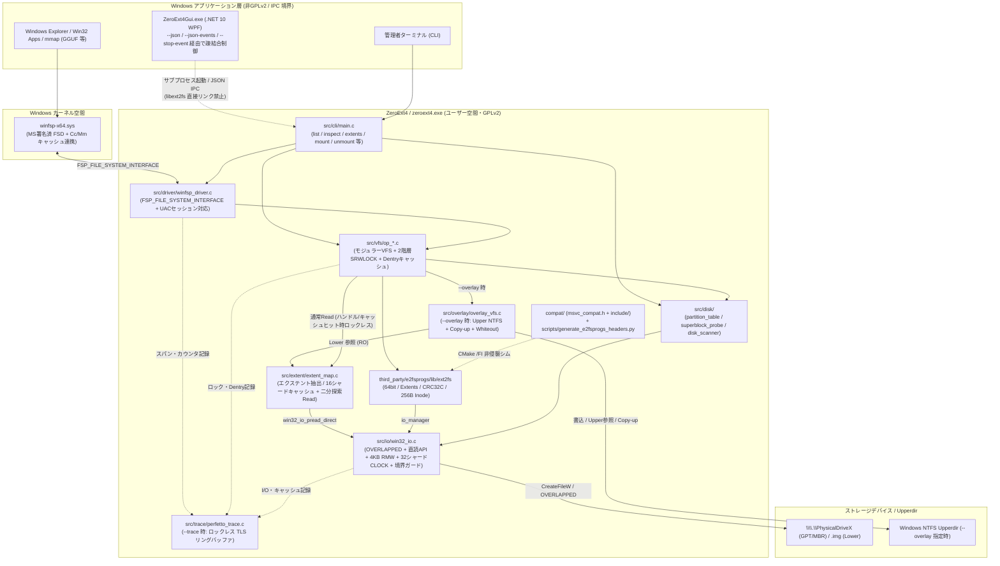
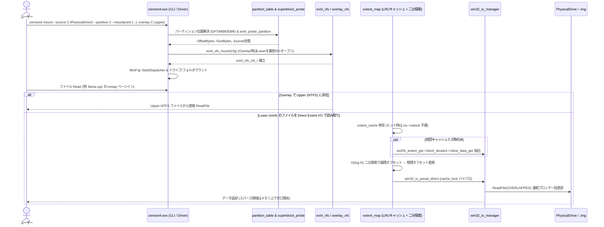

# アーキテクチャ設計書

## 1. システムアーキテクチャ概要

本システムは、カーネルプロキシとしての **WinFsp (`winfsp-x64.sys` / `winfsp-x64.dll`)**、疎結合デスクトップ GUI（`gui/ZeroExt4.Gui/` / `ZeroExt4Gui.exe`）、WinFsp コールバックブリッジ層（`src/driver/`）、NTFS Overlay ルーティング層（`src/overlay/`）、モジュラー VFS 操作層（`src/vfs/op_*.c`）、エクステント直結 I/O エンジン（`src/extent/`）、ディスク・パーティション・ジャーナル検査層（`src/disk/`）、組み込み Perfetto トレーサ（`src/trace/`）、本家 `e2fsprogs` (`third_party/e2fsprogs/` + `compat/`)、および Windows ネイティブ I/O マネージャ（`src/io/win32_io.c`）で構成される。

### 1.1 コンポーネント構成図

### 1.2 マウント ＆ I/O シーケンス

---

## 2. `e2fsprogs` バージョンアップ追従アーキテクチャ

上流の `e2fsprogs` 更新時に手作業のマージコンフリクトなく追従するため、以下の **Zero-Patch 分離構成** を採用する（技術背景は [ADR-0005](adr/0005-zero-patch-e2fsprogs-compat-layer.md)、実装仕様は [詳細設計書 §2](design/detailed-design.md#2-e2fsprogs-互換レイヤー詳細-compat--scripts) を参照）。

1. **ソースツリーへの手動パッチ禁止**: `third_party/e2fsprogs/` 配下へ手書きの `#ifdef _MSC_VER` / `#ifdef _WIN32` 改変を加えず、GCC/POSIX 互換シムはすべて `compat/` へ隔離する。
2. **CMake `/FI` の `PRIVATE` / `INTERFACE` 分離**: `ext2fs` ターゲットには `compat/msvc_compat.h`（警告抑制含む）と `compat/include/` を `PRIVATE` で適用し、呼び出し側ターゲットには最小公開シム `compat/msvc_public_compat.h` のみを `INTERFACE` で伝播させる。
3. **ビルド時ヘッダ・テーブル自動生成**: `scripts/generate_e2fsprogs_headers.py` が `ext2_err.h`, `ext2_err.c`, `ext2_types.h`, `crc32c_table.h` を CMake configure/build 時に生成する。
4. **I/O 抽象化境界の徹底**: OS 依存の `unix_io.c` 等を除外し、公開 ABI である `struct struct_io_manager` を実装した `src/io/win32_io.c` を注入する。
5. **再現可能な自動更新フロー**: MSVC C11 構文制約に対する最小限の上流調整も含め [開発・ビルド・保守ガイド §2](guides/development.md#2-e2fsprogs-アップストリーム更新手順)（`scripts/update_e2fsprogs.ps1`）で再現可能に自動化する。

---

## 3. 重要な設計判断 (ADR: Architecture Decision Records)

主要な技術選定・安全境界・並行制御・キャッシュ／I/O 方針の判断記録は [`docs/adr/`](adr/README.md) に個別の ADR として管理している。

| ADR | 決定内容 | 主な対象コンポーネント | 詳細 |
| :--- | :--- | :--- | :--- |
| `ADR-0001` | 純粋 `.sys` ではなく `WinFsp + ユーザー空間 libext2fs` を採用 | `src/driver/` | [0001-winfsp-and-libext2fs-userspace-driver.md](adr/0001-winfsp-and-libext2fs-userspace-driver.md) |
| `ADR-0002` | `LinuxRoDrive` 等と分離した独立 C/CMake プロジェクト（GPLv2 境界・GUI IPC 疎結合） | `CMakeLists.txt`, `gui/` | [0002-standalone-project-boundary.md](adr/0002-standalone-project-boundary.md) |
| `ADR-0003` | `lwext4` ではなく本家 `e2fsprogs` (`libext2fs`) を採用 | `third_party/e2fsprogs/` | [0003-upstream-libext2fs-over-lwext4.md](adr/0003-upstream-libext2fs-over-lwext4.md) |
| `ADR-0004` | 操作別モジュラー VFS × 64bit API × WinFsp ネイティブ接続 | `src/vfs/`, `src/driver/` | [0004-modular-vfs-64bit-api-and-native-winfsp.md](adr/0004-modular-vfs-64bit-api-and-native-winfsp.md) |
| `ADR-0005` | `compat/` + ヘッダ生成 + 再現スクリプトによる Zero-Patch 互換レイヤー | `compat/`, `scripts/` | [0005-zero-patch-e2fsprogs-compat-layer.md](adr/0005-zero-patch-e2fsprogs-compat-layer.md) |
| `ADR-0006` | `CreateFileW` + `OVERLAPPED` + 4KB RMW + 境界ガード付き `win32_io_manager` | `src/io/win32_io.c` | [0006-custom-win32-io-manager.md](adr/0006-custom-win32-io-manager.md) |
| `ADR-0007` | 階層化 `SRWLOCK`（Shared Read / Exclusive Write）と単一方向ロック順序固定 | `src/vfs/`, `src/io/` | [0007-two-tier-srwlock-concurrency.md](adr/0007-two-tier-srwlock-concurrency.md) |
| `ADR-0008` | マウント前 JBD2 / エラー検査による Dirty 時 RW 拒否と RO フォールバック | `src/disk/`, `src/vfs/op_init.c` | [0008-dirty-journal-safety-guard.md](adr/0008-dirty-journal-safety-guard.md) |
| `ADR-0009` | 管理者権限マウント時の `\\.\X:` 優先登録＋シェルセッション偽装補完 | `src/driver/winfsp_driver.c` | [0009-elevated-drive-letter-visibility.md](adr/0009-elevated-drive-letter-visibility.md) |
| `ADR-0010` | 自己完結 WinFsp ABI 構造体定義とコンパイル時 `FSP_ABI_ASSERT` | `third_party/winfsp/` | [0010-winfsp-abi-layout-assertions.md](adr/0010-winfsp-abi-layout-assertions.md) |
| `ADR-0011` | `UmFileContextIsUserContext2 = 1` による 1 オープン＝1 クローズ保証 | `src/driver/`, `src/vfs/ext4_vfs.h` | [0011-handle-context-via-user-context2.md](adr/0011-handle-context-via-user-context2.md) |
| `ADR-0012` | Lower RO 限定（RO / `--overlay` 既定 ON・`--rw` 自動無効）Direct Extent I/O | `src/extent/`, `src/vfs/op_read.c` | [0012-lockless-direct-extent-io-ro-overlay-default.md](adr/0012-lockless-direct-extent-io-ro-overlay-default.md) |
| `ADR-0013` | NTFS Upperdir Overlay と `.wh.__ext4_lower_id` Lower-ID 照合 | `src/overlay/` | [0013-ntfs-overlay-mount-and-lower-id-guard.md](adr/0013-ntfs-overlay-mount-and-lower-id-guard.md) |

