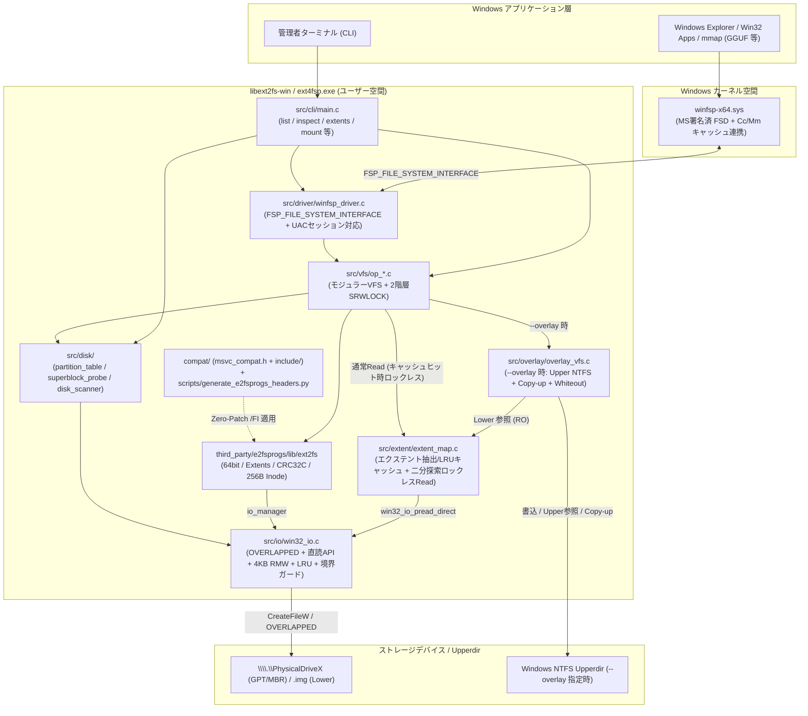
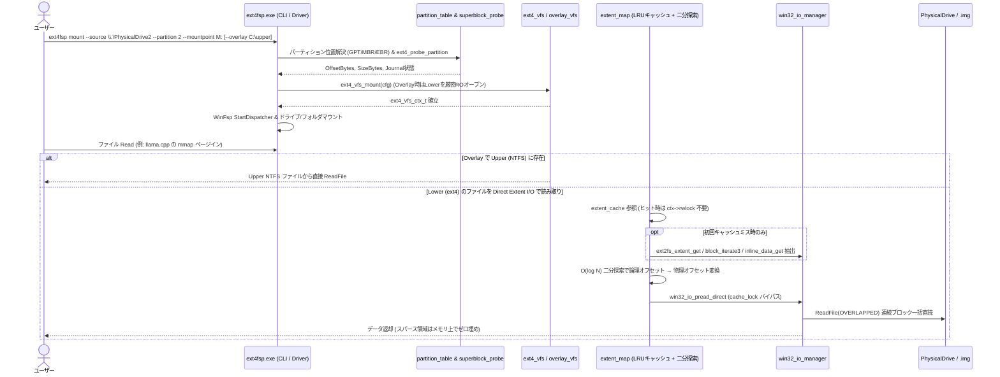

# アーキテクチャ設計書・設計判断記録 (ADR)

## 1. システムアーキテクチャ概要

本システムは、カーネルプロキシとしての **WinFsp (`winfsp-x64.sys` / `winfsp-x64.dll`)**、WinFsp コールバックブリッジ層（`src/driver/`）、NTFS Overlay ルーティング層（`src/overlay/`）、モジュラー VFS 操作層（`src/vfs/op_*.c`）、エクステント直結 I/O エンジン（`src/extent/`）、ディスク・パーティション・ジャーナル検査層（`src/disk/`）、本家 `e2fsprogs` (`third_party/e2fsprogs/` + `compat/`)、および Windows ネイティブ I/O マネージャ（`src/io/win32_io.c`）で構成される。

### 1.1 コンポーネント構成図

### 1.2 マウント ＆ I/O シーケンス

---

## 2. `e2fsprogs` バージョンアップ追従アーキテクチャ

上流の `e2fsprogs` 更新時にマージコンフリクトなく追従するため、以下の **Zero-Patch 分離構成** を採用する。

1. **ソースツリーの完全分離**: `third_party/e2fsprogs/` 配下には `#ifdef _MSC_VER` や `#ifdef _WIN32` 等の Windows 固有記述を一切含めない。
2. **CMake `/FI` 強制インクルードと `compat/include/`**: `CMakeLists.txt` で `ext2fs` ターゲットにのみ `/FI.../compat/msvc_compat.h` と `compat/include/` を適用し、`__attribute__` や `<unistd.h>` 等の GCC/POSIX 依存を非侵襲で吸収する。
3. **ビルド時ヘッダ・エラーテーブル自動生成**: `scripts/generate_e2fsprogs_headers.py` が `ext2_err.et.in` と `ext2_types.h.in` から `ext2fs/ext2_err.h`, `ext2_err.c`, `ext2fs/ext2_types.h` を CMake ビルド時に生成する。
4. **I/O 抽象化境界の徹底**: OS 依存の `unix_io.c` 等はビルド対象から外し、公開 ABI である `struct struct_io_manager` を実装した `src/io/win32_io.c` を注入する。
5. **更新検証自動化**: `scripts/update_e2fsprogs.ps1` により、新バージョンの同期・ビルド・`ctest` 検証を一貫実行する。

---

## 3. 重要な設計判断とその根拠（ADR: Architecture Decision Records）

### ADR-001: 純粋カーネルドライバ (`.sys`) ではなく `WinFsp + libext2fs` を採用する
- **決定**: カーネル空間 FSD (`.sys`) を自作せず、WinFsp をカーネルプロキシとしたユーザー空間ドライバ (`.exe`) として実装する。
- **比較検討した選択肢**:
  - 案A: 純粋な Windows カーネルドライバ (`.sys`) での自作
  - 案B: WinFsp + ユーザー空間 `libext2fs`（採用）
- **根拠**:
  1. `libext2fs` は標準 C ライブラリ（`malloc`, `errno`, POSIX I/O）を前提としており、`ntoskrnl.exe` 内の IRQL・ページング制約環境へそのままリンク・移植することは困難。
  2. Windows FSD では Cache Manager (`Cc`) および Memory Manager (`Mm` / ページング I/O / `mmap`) との協調実装が最難関となるが、WinFsp が MS 署名済みカーネルドライバとしてこれらを代行するため、大容量 Read や `mmap` でも高速かつ安全に動作する。
  3. ユーザー空間プロセスであるため開発時・運用時のバグで BSOD を起こさず、Windows 11 の EV コード署名＋Microsoft Attestation Signing も不要となる。

### ADR-002: 独立プロジェクト (`libext2fs-win`) として分離開発する
- **決定**: 既存の Read-Only ツール群（`LinuxRoDrive` 等）へ組み込まず、独立したリポジトリ・C/CMake プロジェクトとして開発する。
- **根拠**:
  1. **安全性モデルの境界**: 「外部ドライバ不要・100% Read-Only」を前提とする設計と、「WinFsp 導入・`GENERIC_WRITE` による物理ディスク直接書き込み」を伴う設計はリスク特性が真逆であり、同一プロセスへ混在させると安全保証の境界が曖昧になる。
  2. **技術スタック・ビルド分離**: .NET / C# ソリューションへ C/CMake/MSVC ネイティブビルドや `e2fsprogs` ビルドを混在させると保守コストが急増する。
  3. **ライセンス分離**: `libext2fs` は GPLv2 ライセンスであり、他プロジェクトと静的・直接統合すると全体へコピーレフトが波及する。単体 CLI/ドライバとして分離しておけば、必要時にサブプロセスとして疎結合に連携できる。

### ADR-003: `lwext4` ではなく本家 `e2fsprogs` (`libext2fs`) を採用する
- **決定**: 組み込み向け軽量ライブラリ `lwext4` ではなく、本家 `libext2fs` をコアに採用する。
- **根拠**:
  1. `lwext4` は数 KB〜数十 KB のマイコン環境向けであり、固定・小規模ブロックキャッシュおよび単一全体ロックになりやすく、デスクトップ PC の潤沢な RAM とマルチコアを活用した大容量ファイル転送では性能が頭打ちになりやすい。
  2. 最新 Linux 環境がデフォルトで有効化する `64bit`・`metadata_csum`（CRC32C）・HTree 大規模ディレクトリへの追従性と信頼性において、本家 `e2fsprogs` 準拠の `libext2fs` が優れている。

### ADR-004: `fuse-ext2` 型モジュラー構造 × 64bit API × WinFsp ネイティブのハイブリッド設計
- **決定**: `fuse-ext2` のそのままの移植や FUSE 互換層経由ではなく、「操作別の `src/vfs/op_*.c` モジュール分割」×「`fuse2fs` 相当の最新 64bit `libext2fs` API」×「WinFsp ネイティブコールバック (`FSP_FILE_SYSTEM_INTERFACE`)」のハイブリッド構成とする。
- **根拠**:
  1. 従来型 `fuse-ext2` 設計には 32bit API 依存の箇所が残り、`64bit` / `metadata_csum` 環境での RW 書き込みにリスクがある。一方 `fuse2fs` 型の単一巨大ソース構成は保守・単体テストの分離性に劣る。
  2. 操作ごとに `op_init.c`〜`op_flush.c` へ分割することで責務が明確になり、VFS 単体テストや問題切り分けが容易になる。
  3. FUSE 変換層を介さず WinFsp の `FSP_FILE_SYSTEM_INTERFACE` へ直接接続することで、Windows 固有属性（`FILE_ATTRIBUTE_*`、100ns `FILETIME`、Delete-on-Close、カーネルキャッシュ `FileInfoTimeout`）を最小オーバーヘッドで制御できる。

### ADR-005: `e2fsprogs` 追従性を担保する Zero-Patch 互換レイヤー設計
- **決定**: `third_party/e2fsprogs/` に Windows 向けパッチを入れず、`compat/msvc_compat.h`（`/FI`）・`compat/include/`・`scripts/generate_e2fsprogs_headers.py` のみに互換コードを局所化する。
- **根拠**: 上流 `e2fsprogs` のバージョンアップ時に手作業パッチの再適用やマージ衝突解消を不要とし、ファイル同期と自動生成＋テスト実行だけで安全に追従できるようにするため。

### ADR-006: カスタム `struct_io_manager` (`win32_io_manager`) 設計
- **決定**: `unix_io.c` を置換し、`CreateFileW` + `OVERLAPPED` + セクタ境界アライメント RMW（`_aligned_malloc`）+ パーティション境界ガード + スレッドセーフ LRU ブロックキャッシュを実装する。
- **根拠**:
  1. Windows の生ディスクハンドル（`\\.\PhysicalDriveX`）は物理セクタ境界（512B/4096B）およびバッファメモリアライメント制約を持ち、1024B/2048B ブロックや非アライメントアクセスを直接行うと `ERROR_INVALID_PARAMETER` で失敗する。I/O 層で RMW を吸収することで上位 FS ロジックを簡潔に保てる。
  2. `OVERLAPPED` で毎回 64bit オフセットを指定することにより、ファイルポインタ共有競合を排除し並列 Read を安全化できる。
  3. `[partition_offset_bytes, partition_offset_bytes + partition_size_bytes)` による厳密な境界チェックにより、同一ディスク上の Windows パーティションや GPT テーブルへの誤書込を物理層で防止できる。

### ADR-007: 2 階層 `SRWLOCK` によるマルチスレッド同期設計
- **決定**: `ext4_vfs_ctx_t` に `SRWLOCK rwlock` を配置し、Read/Stat/ReadDir 系は共有ロック（`AcquireSRWLockShared`）で並列実行を許可し、Write/Create/Mkdir/Unlink/Rename/Truncate/Flush 系は排他ロック（`AcquireSRWLockExclusive`）で直列化する。また `win32_io` の LRU キャッシュは独立の `SRWLOCK cache_lock` で保護する。
- **根拠**: `libext2fs` の内部キャッシュやビットマップ操作はスレッドセーフでないためメタデータ変更は直列化が必須である一方、データ読み取り系に共有ロックを許可することでマルチスレッド読み出しスループットを確保できる。なお、デッドロック防止のためロック取得順序は **`ctx->rwlock` → `cache_lock`** の一方向に固定する。

### ADR-008: Dirty Journal 検出時の安全機構（RW 拒否 / RO フォールバック）
- **決定**: マウント前にスーパーブロックの `EXT3_FEATURE_INCOMPAT_RECOVER` / `EXT2_ERROR_FS` およびジャーナル inode (`s_journal_inum`) 先頭の JBD2 スーパーブロック（Magic `0xC03B3998`, `s_start != 0`, `s_errno != 0`）を検査し、Dirty またはエラー検出時は RW マウントを拒否する（`ro_fallback_on_dirty` 指定時は Read-Only へ自動切替、`force_rw_on_dirty` 指定時のみ許可）。
- **根拠**: `libext2fs` 単体は Linux カーネルの JBD2 トランザクション自動再生を行わないため、未コミットジャーナルが残るボリュームへそのまま書き込むとファイルシステム破損・データ消失につながる。マウント前検査によって意図しない破壊を確実に抑止する。

### ADR-009: 管理者権限実行時のドライブレター可視性（Mount Manager 優先 + デスクトップユーザーセッションへのフォールバック）
- **背景**: 物理ディスク (`\\.\PhysicalDriveN`) を開くには昇格済み管理者トークンが必要。一方、WinFsp の `FspFileSystemSetMountPoint(fs, L"X:")` は（`LOCAL_SYSTEM` 以外では）内部で `DefineDosDeviceW` を呼び、ドライブレターを **呼び出し元ログオンセッションの `DosDevices`** にのみ作成する。UAC の分割トークンにより、昇格セッションと非昇格の Explorer はログオン ID が異なるため、「マウント成功と表示されるのに Explorer にドライブが現れない」現象が発生した。
- **決定**: マウントポイントがドライブレター (`X:`) で、かつプロセスが昇格済みの場合:
  1. まず WinFsp が公式にサポートする `\\.\X:` 形式で `SetMountPoint` を呼び、**Mount Manager 経由のグローバルドライブレター**（全セッションから可視）として登録する。
  2. これが失敗した場合は `X:` で通常マウントしたうえで、シェル (`GetShellWindow` → `explorer.exe`) のトークンを複製して `ImpersonateLoggedOnUser` し、**デスクトップユーザーのセッションにも** `DefineDosDeviceW(DDD_RAW_TARGET_PATH, "X:", \Device\Volume{...})` を定義する。アンマウント時は同じ偽装下で `DDD_REMOVE_DEFINITION | DDD_EXACT_MATCH_ON_REMOVE` によって削除する。
  3. いずれの場合も `SHChangeNotify(SHCNE_DRIVEADD/SHCNE_DRIVEREMOVED)` で Explorer に通知する。
- **根拠**: Mount Manager 方式は WinFsp 標準機能であり、OS 側でドライブを管理するため最も堅牢。CSRSS (`BaseSrvDefineDosDevice`) は呼び出しスレッドの実効トークンで対象セッションを決めるため、偽装によるフォールバックで非昇格 Explorer の名前空間に確実に定義できる。非昇格実行時（イメージファイルのマウントなど）は従来どおり `X:` をそのまま使用する。

### ADR-010: WinFsp ABI 構造体レイアウトの検証
- **決定**: SDK に依存しない自前ヘッダ `third_party/winfsp/include/winfsp/winfsp.h` の `FSP_FSCTL_VOLUME_PARAMS` (504 bytes)、`FSP_FSCTL_FILE_INFO` (72 bytes)、`FSP_FSCTL_DIR_INFO` (`FileNameBuf` @ 0x68) を公式 WinFsp 2.x ABI 仕様と照合し、コンパイル時アサーション (`FSP_ABI_ASSERT`) で固定した。
- **根拠**: 旧定義はビットフィールド位置（`AllowOpenInKernelMode` 以降が bit 18 からずれていた）と末尾サイズ (512 bytes) が公式と食い違っており、`Version` に誤ったサイズを渡していた。ABI の不一致はカーネルドライバへのパラメータ誤伝達に直結するため、ビルド時に検出できるようにする。

### ADR-011: `UmFileContextIsUserContext2 = 1` によるハンドル単位コンテキスト管理
- **決定**: `FSP_FSCTL_VOLUME_PARAMS.UmFileContextIsUserContext2` を `1` に設定し、`FspOpen` / `FspCreate` が返す `ext4_file_handle_t *` を WinFsp の `UserContext2`（オープンハンドル／`FILE_OBJECT` 単位の `FileDesc`）として扱う。
- **根拠**: `UmFileContextIsUserContext2 = 0`（既定）では `UserContext`（`FileNode` スロット）が使われ、並列アクセス時に同一パスに対する複数のクローズ要求が同一ポインタへ配送されて二重解放 (`STATUS_HEAP_CORRUPTION` / `0xC0000374`) および解放済みポインタ参照が発生する。`ext4_file_handle_t` は `create_options` / `delete_on_close` / `open_writable` を保持するオープン単位の構造体であるため、`UserContext2` に割り当てることで 1 オープン＝1 クローズが保証される。

### ADR-012: 明示指定かつ RO 専用のロックレス・エクステント直結 I/O (`src/extent/`, `--direct-io`)
- **決定**: ダイレクト・エクステント I/O エンジンは `--direct-io`（`enable_direct_io = 1`）を明示的に指定した場合に限り、かつ下位 ext4 ボリュームが Read-Only（既定の RO マウントまたは `--overlay`）で開かれている場合のみ有効化する。非 Overlay の `--rw` マウントと `--direct-io` の同時指定はマウント時に `-EINVAL` で拒否し、既定状態（`enable_direct_io = 0`）および RW 時は `extent_cache` を生成せず `ext2fs_file_read` 経由で処理する。
- **根拠**:
  1. 大容量ファイル（GGUF モデルの `mmap` ロードや VM イメージ等）に対する大量ページイン時に毎回 `ext2fs_file_open` / `llseek` / ブロック単位の `cache_lock` を通過するコストをなくすため、有効化時は inode のエクステント配列（多段ツリー・間接ブロック・インライン・未初期化・スパースに対応し隣接連続領域を結合）をキャッシュし、`O(log N)` 二分探索＋`ctx->rwlock` を保持しない `win32_io_pread_direct` へ流す（多段ツリーは `EXT2_EXTENT_ROOT` 直後に `EXT2_EXTENT_DOWN` で最初のリーフへ降りて枝 0 のスキップを防ぐ）。
  2. 一方、RW マウント下でロックレス直読を行うと、`libext2fs` 内部ファイルバッファ（`file->buf`）の未フラッシュデータとディスク上の旧データ・エクステントヘッダ書換中間状態との間で Read-after-Write 不整合リスクが生じるため、RW 時を最初から抑止して設計・検証を単純かつ安全に保つ。

### ADR-013: NTFS を Upper 層とする非破壊 Overlay マウント (`src/overlay/`) と Lower-ID 照合
- **決定**: `--overlay <upper_ntfs_dir>` 指定時は、Lower の ext4 ボリュームを常に厳密 Read-Only (`GENERIC_READ`、Dirty Journal でも安全オープン可) に固定し、Windows NTFS 上の指定フォルダを Upper 層とする OverlayFS 互換 VFS（`src/overlay/overlay_vfs.c`）を有効化する。さらに Upperdir ルートに隠しマーカー `.wh.__ext4_lower_id`（Lower の `s_uuid` + ブロック数 + ブロックサイズ）を記録し、既存 Upperdir 再利用時に別 Lower との不一致を検出した場合はマウントを拒否 (`-EINVAL`) する。またマーカー未設定の非空ディレクトリに対しては警告ログを出した上で ID を記録する。
- **根拠**: デュアルブート環境や Linux ワークスペース上の大容量ファイルへ高速アクセス（`--direct-io` 併用可）しつつ Windows 側出力物を NTFS に逃がす用途では、Lower への書き込みリスクをゼロに保つ必要がある。同一 Upperdir を誤って別 Lower に流用すると古いホワイトアウト (`.wh.<name>`) や `.wh.__dir_opaque`、古い Copy-up ファイル、inode 衝突が新 Lower へ誤適用される危険があるため、マウント時に Lower の UUID 等で拘束・検証する。

