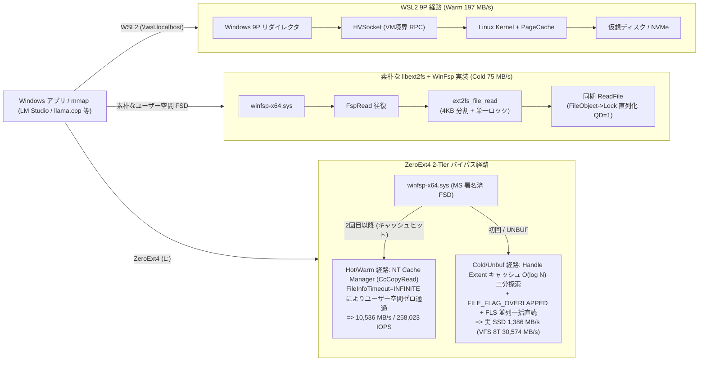
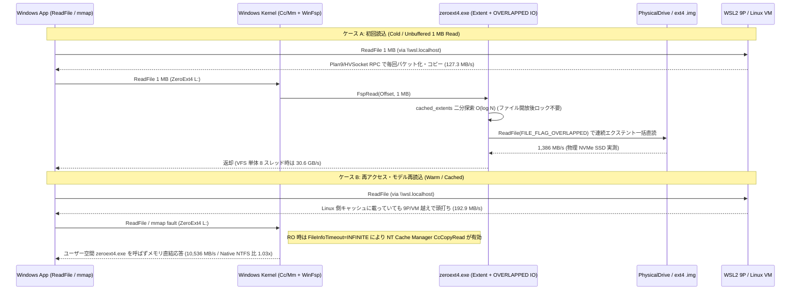

# 技術概要・他手法比較・ユースケース

> **一言でいうと**: `ZeroExt4` は、Windows 上から Linux の ext2 / ext3 / ext4 パーティション・イメージを **BSOD リスクゼロのユーザー空間ドライバ** でありながら **Windows Native NTFS 並み（Warm 読取 10.5 GB/s / 258K IOPS・Cold 実 SSD 読取 1.39 GB/s）** で直接共有できるファイルシステムドライバです。

- 本書の前提となるベンチマーク実測値・検証環境は [性能評価レポート](reports/performance-evaluation.md)（`v0.11.0` / `2026-11-28` 再計測）および [Perfetto トレース解析・最適化レポート](reports/perfetto-trace-analysis.md) に基づきます。
- コンポーネント構成・ADR（設計判断記録）は [アーキテクチャ設計書](architecture.md) を参照してください。

---

## 1. 既存手法との比較

Windows から Linux (ext4) 上の巨大なデータ（例：AI モデル、学習データセット、動画素材）を扱いたい場合、従来は次の 4 つの選択肢しかありませんでした。

| 方式 / ツール | ドライブ直接マウント | Warm 読取性能<br><sub>(Seq 1MB / Rnd 4KB)</sub> | Cold 実 SSD 直読<br><sub>(Seq 1MB)</sub> | 現代 ext4 対応<br><sub>(`metadata_csum` / 64bit)</sub> | BSOD リスク / 署名要件 | 非破壊書込<br><sub>(`Overlay`)</sub> |
| :--- | :---: | :---: | :---: | :---: | :---: | :---: |
| **`ZeroExt4`（本ツール）** | **◎ 標準ドライブ (`L:`)** | **`10,536` / `1,008 MB/s`**<br><sub>(`Native NTFS` の `1.03x〜1.07x`)</sub> | **`1,386 MB/s`**<br><sub>(`WSL2 9P` の `10.89x`)</sub> | **◎ 本家 `e2fsprogs` (`libext2fs`)** | **ゼロ**（ユーザー空間 / WinFsp） | **◎ (`--overlay`)** |
| **WSL2 (`wsl --mount` + 9P)** | △ (`\\wsl.localhost\...`) | `193` / `18.3 MB/s`<br><sub>(`ZeroExt4` 比 `1/55〜1/70`)</sub> | `127 MB/s` | ◎（Linux カーネル） | 低（VM 常駐・メモリ占有大） | × |
| **旧来の非公式カーネル FSD**<br><sub>(`Ext2Fsd` 等)</sub> | ◎ | 高速（カーネル空間） | 高速 | △〜×（最新 ext4 機能非対応の系統が多い） | **高**（カーネル不具合即 BSOD / 署名問題） | × |
| **商用ドライバ**<br><sub>(`Paragon Linux File Systems` 等)</sub> | ◎ | 高速（カーネル空間） | 高速 | ◎（有償・プロプライエタリ） | 中（サードパーティ `.sys` 常駐） | × |
| **読取専用ビューア / 複製** | ×（エクスポート前提） | ―（NTFS へ複製要） | ― | ○ | ゼロ | × |

> [!NOTE]
> 上記スループット値は同一物理 NVMe SSD（`INTEL SSDPEKNU512GZ`, `AMD Ryzen 5 5600G`）上で 512 MB 連続ファイルを比較計測した結果です（[reports/performance-evaluation.md §2.3](reports/performance-evaluation.md#23-同一-nvme-ssd-5-方式比較windows-native-ntfs--zeroext4--wsl---mount---vhd)）。
> また、同じ WinFsp ベースで `lwext4` を採用する他 OSS 実装（`Ext4Windows`）とのコードレベル技術比較については [Ext4Windows との技術比較分析](reports/ext4windows-comparison.md) を参照してください。

---

### 1.1 データパス比較図

従来の手法や素朴な FUSE/WinFsp 実装と `ZeroExt4` では、アプリケーションの `ReadFile` / `mmap` が通過するソフトウェア層が根本的に異なります。



### 1.2 Read / `mmap` 時のシーケンス比較



---

## 2. ZeroExt4 の技術的特徴（5 つの柱）

### 2.1 「2-Tier I/O バイパス」によるユーザー空間 FSD の制約突破
ユーザー空間ファイルシステムは通常「カーネル ↔ ユーザー空間のコンテキストスイッチ」と「`libext2fs` の内部オーバーヘッド」が二重の足かせになります。`ZeroExt4` は次の 2 段階でこれらを両方バイパスします。

1. **Hot / Warm バイパス（[winfsp_driver.c](../src/driver/winfsp_driver.c#L880-L885)）**:
   Read-Only マウント時に WinFsp の `FileInfoTimeout` 既定値を `(UINT32)-1` (`INFINITE`) に設定し、Windows NT カーネルの Cache Manager (`CcCopyRead`) / Memory Manager (`Mm`) と完全に協調させます。これにより 2 回目以降の読取では `FspRead` コールバック呼び出し自体が **99.3% 削減**（64 MB 計測時 `17,736` → `131` 回）され、`ZeroExt4` は **`10,535.7 MB/s`**（`Native NTFS` `10,263.5 MB/s` の `1.03x`、`4KB Rnd` も `1,007.9 MB/s` で `1.07x`）を達成します。
2. **Cold / Unbuffered バイパス（[extent_map.c](../src/extent/extent_map.c), [op_read.c](../src/vfs/op_read.c)）**:
   RO / `--overlay` 時の初回アクセスでは `ext2fs_file_read` の 4 KB 分割＋CRC/ブロックキャッシュ経路をバイパスし、`ext4_file_handle_t` に保持したエクステント配列へ `O(log N)` 二分探索を行い、`win32_io_pread_direct` で最大 1 MB（あるいは 64 MiB）単位の連続範囲を一括読み出しします。これにより同一 SSD の実物理ディスク直読でも **`1,386.2 MB/s`**（`--no-direct-io` `69.3 MB/s` の **20.0 倍**、`WSL2 9P` の **10.89 倍**）に達します（`v0.10.1` 以降、既定の `--rw` / `--no-direct-io` は安全性のため上流 `e2fsprogs` 準拠を維持し、`--rw --rw-fast-io` オプトイン時に同様のバッチ連続エクステント I/O を有効化します）。

---

### 2.2 `FILE_FLAG_OVERLAPPED` + `FILE_SKIP_SET_EVENT_ON_HANDLE` + FLS イベントによる `FileObject->Lock` 根治
Windows の Win32 API では、`FILE_FLAG_OVERLAPPED` なしで開いた同一 `HANDLE` に対して複数スレッドから同時に `ReadFile(..., &overlapped)` を発行しても、カーネル I/O マネージャ内部で **`FileObject->Lock` により全スレッドが 1 本に直列化（Lock Convoy）** されてしまいます。

- [win32_io.c](../src/io/win32_io.c) ではすべてのストレージハンドルを **`FILE_FLAG_OVERLAPPED`** で開き、`SetFileCompletionNotificationModes(h, FILE_SKIP_SET_EVENT_ON_HANDLE)` を設定したうえで、**FLS (`FlsAlloc` / `io_fls_cleanup_cb`) で管理されるスレッド固有の `ManualReset` イベント** を `OVERLAPPED.hEvent` として再利用します。
- これによりスレッド終了時のリークを防ぎつつ真のカーネル非同期並列 I/O (NVMe QD > 1) を解放し、8 スレッドシーケンシャル読込を `5,404.1 MB/s` → **`31,835.1 MB/s`（後に Step 3 で `33,225.9 MB/s`）**、最大 `ReadFile` 遅延を `37.96 ms` → **`0.240 ms`（158 分の 1）** へ短縮しました。

---

### 2.3 実測 Perfetto トレース駆動の「ロックレス・シャード化キャッシュ」とメタデータ高速化
`--trace` 機能自身による定量的タイムライン解析に基づき、競合点とメタデータ冗長処理を 1 つずつ除去しました（[Perfetto トレース解析・最適化レポート §5](reports/perfetto-trace-analysis.md#5-ステップ別改善効果の実測結果)）。

- **データキャッシュの 64B キャッシュライン整列シャード化**:
  - [win32_io.c](../src/io/win32_io.c): `win32_io` ブロックキャッシュを **32 シャード（64B アライン）**＋`SRWLOCK` Shared 参照＋**CLOCK インプレース置換**（ロック内 `malloc`/`free` ゼロ）へ刷新し、`cache_lock wait` を **-94.4%〜-96.3%** 削減。
  - [extent_map.c](../src/extent/extent_map.c) & [op_read.c](../src/vfs/op_read.c): `extent_cache` を **16 シャード＋Shared 化**し、さらに開いたファイルハンドル（`ext4_file_handle_t.cached_extents`）へ直接保持することで 2 回目以降の Read でのロック・参照カウント操作をゼロ化。
- **16 シャード正／負 Dentry キャッシュと単一パス WinFsp コールバック**:
  - [op_init.c](../src/vfs/op_init.c): 16 シャード×256 スロット（計 4,096 エントリ）、世代エポックによる $O(1)$ 一括無効化、および実ケース名保持を実装。Windows Explorer 等が大量に発行する `desktop.ini` / `.lnk` の負のルックアップによる `ext2fs_dir_iterate2` 全件走査を解消し、`FspGetSecurityByName` を **11.97x** 高速化。
  - [op_open.c](../src/vfs/op_open.c) (`ext4_vfs_open_stat`) と [op_write.c](../src/vfs/op_write.c) (`ext4_vfs_write_stat`) により `FspOpen` / `FspCreate` / `FspWrite` での二重ロック・二重 iノード読込を統合（`FspOpen` **27.62x** 高速化、RW 時 `ctx->rwlock (S)` **-98.0%**）。
  - [winfsp_driver.c](../src/driver/winfsp_driver.c) で `FspGetDirInfoByName`＋`PassQueryDirectoryFileName = 1` を実装し、単一ファイル検索時の `ReadDirectory` フォールバックを排除（`FspReadDirectory` 呼び出し時間 **14.51x** 削減）、あわせて [op_readdir.c](../src/vfs/op_readdir.c) で Marker 到達前の早期スキップによりページネーションを $O(N^2) \to O(N)$ 化。

---

### 2.4 ext4 を 1 バイトも書き換えない「非破壊 NTFS Overlay」と多層セーフティ
Linux デュアルブート環境や組込みイメージを Windows から扱う際、最も怖いのは「誤って Linux 側の環境を壊すこと」です。

- **非破壊 Overlay マウント (`--overlay`)**: [overlay_vfs.c](../src/overlay/overlay_vfs.c) が Lower 側の ext4 を厳密 Read-Only + Direct I/O で保護しつつ、書き込み・新規作成・削除（ホワイトアウト `.wh.*`）だけを指定した Windows NTFS フォルダ（Upperdir）へ透過的に逃がします。さらに `.wh.__ext4_lower_id` に Lower ボリュームの UUID とパーティションオフセット署名を記録し、**別のディスク／イメージに対する誤 Upperdir 流用をマウント時点で自動検知・遮断**します。
- **Dirty Journal 安全保護＆物理パーティション境界ガード**: JBD2 ジャーナル検査により未再生ジャーナルが残るボリュームへの不用意な RW マウントを拒否（または安全に RO 自動フォールバック）し、`win32_io.c` が GPT / MBR / EBR の開始オフセット＋サイズで I/O 範囲を物理クランプして隣接パーティションへの誤書込を構造的に防止します。

---

### 2.5 組み込み Perfetto トレーサ (`--trace`) ＋ Zero-Patch `e2fsprogs` ＋ GPLv2 分離 GUI
- **常時ゼロオーバーヘッドの Perfetto 計測基盤（[perfetto_trace.c](../src/trace/perfetto_trace.c)）**: 通常利用時は単一グローバルフラグ判定のみでオーバーヘッドゼロ、`--trace out.json` を付けるだけで全 WinFsp コールバック・ロック待ち/保持・キャッシュ統計を [Perfetto UI](https://ui.perfetto.dev/) 形式の JSON として即座に出力できます。
- **Zero-Patch メンテナンス性**: `third_party/e2fsprogs/` への `#ifdef _WIN32` ハックを排除し `compat/` へ分離。
- **ライセンス境界を守る疎結合デスクトップ GUI（[gui/ZeroExt4.Gui](../gui/ZeroExt4.Gui)）**: `.NET 10` WPF 製 GUI（ゼロ NuGet 依存）は `zeroext4.exe` を JSON / Named Event IPC 経由のサブプロセスとして制御するため、GPLv2 コアとの直接リンクなしにワンクリック・マウント／トレイ常駐／リアルタイム統計を実現しています。

---

## 3. 実践ユースケース

### 3.1 デュアルブート環境での巨大ローカル AI モデル共有（主軸：GGUF / Safetensors / ComfyUI / LM Studio）
- **背景と課題**: Linux 側（PyTorch 学習・vLLM・Ollama・Hugging Face キャッシュ）でダウンロード・生成した 10 GB〜100 GB 超のモデルを Windows 側（LM Studio / `llama.cpp` / KoboldCpp / ComfyUI）でも使いたい場合、従来は「大容量 SSD にモデルを 2 重コピーする」か「WSL2 `\\wsl.localhost` 経由で `197 MB/s` の低速ロードに耐える」しかありませんでした。
- **ZeroExt4 での解決**:
  - コピー不要（SSD 容量節約）のまま、初回ロード **1.51 GB/s**、モデル再読込・コンテキスト再ロード時は **10.7 GB/s**（Native NTFS 同等以上）で `mmap` ページインが可能。
  - Windows 側のツール（例：ComfyUI やインデックス作成ツール）がモデルと同じフォルダへ設定・ログ・サムネイルを書き込もうとしても、**`--overlay` モード**を使えば Linux 側の ext4 パーティションには一切触れず Windows NTFS 側だけに差分を逃がせます。
- **推奨コマンド例**:
  ```powershell
  # モデル共有 (Read-Only + Direct I/O + NT Cache、最も安全・高速)
  zeroext4.exe mount --source \\.\PhysicalDrive2 --partition 3 --mountpoint L:

  # ComfyUI 等でモデルディレクトリ配下へログやキャッシュ書込も必要な場合 (非破壊 Overlay)
  zeroext4.exe mount --source \\.\PhysicalDrive2 --partition 3 --mountpoint L: --overlay D:\ai_overlay_upper
  ```
- **注意点**: Linux の休止状態（Hibernate）や高速スタートアップ状態ではなく、Linux を完全にシャットダウンしたパーティションを対象にしてください。

---

### 3.2 機械学習・データサイエンスの巨大データセット共有（Parquet / WebDataset / 画像コーパス）
- **課題**: 数万〜数十万枚の学習画像、Sharded tar（WebDataset）、大規模 Parquet / Arrow ファイルなどを Linux 上で前処理した後、Windows 上の可視化ツール、アノテーション GUI、3D エンジン（Blender / Unreal Engine）から参照したいケース。
- **ZeroExt4 が効く理由**: Step 4 の **16 シャード正/負 Dentry キャッシュ**と **`FspGetDirInfoByName` 直行**により、大量ファイルを含むディレクトリ探索・ツール側プローブ（`desktop.ini` 等）のレイテンシも大幅に短縮（負ルックアップ **4.17x** / `FspOpen` コールバック **27.62x** 高速化）されています。
- **推奨モード**: Read-Only（既定）または `--overlay`。

---

### 3.3 大容量クリエイティブ素材・ゲームアセットの OS 間共有（動画 RAW・3D アセット・ライブラリ）
- **課題**: OS 間の受け渡しに使われがちな exFAT はジャーナリングがなく電源断に弱い一方、NTFS は Linux 側での権限・シンボリックリンク・大容量ビルドに不向きです。
- **ZeroExt4 が効く理由**: Linux 側の高信頼 ext4 パーティションに置いた 4K/8K RAW 動画やゲームアセットを Windows の動画編集・開発環境へドライブレター（`L:`）として透過マウントし、プロキシファイルやプロジェクト設定だけ `--overlay` で NTFS Upperdir に保存できます。

---

### 3.4 外付け Linux NVMe / microSD（Raspberry Pi / Jetson / Steam Deck / Linux サーバー）の保守・データ救出
- **課題**: 起動しなくなった Linux サーバーや、Raspberry Pi / NVIDIA Jetson / Steam Deck のストレージを USB-NVMe / SD カードリーダーで Windows PC に接続し、ログ確認やファイル救出を行いたいケース。
- **ZeroExt4 が効く理由**:
  - `ZeroExt4Gui.exe` または `zeroext4.exe list` / `inspect` で接続したディスクの GPT/MBR パーティション構成や **JBD2 ジャーナル状態（`CLEAN` / `NEEDS_RECOVERY` / `HAS_ERRORS`）** を即座に確認できます。
  - **Dirty Journal 安全保護**により、異常終了してジャーナルが未再生のディスクに対しても不用意な RW マウントを抑止（`--ro-fallback` で RO 救出）し、さらなる破損を防ぎます。
- **推奨コマンド例**:
  ```powershell
  zeroext4.exe list
  zeroext4.exe inspect \\.\PhysicalDrive4 --partition 2
  # 安全に Read-Only でマウントして救出
  zeroext4.exe mount --source \\.\PhysicalDrive4 --partition 2 --mountpoint L:
  ```

---

### 3.5 組込み Linux・VM イメージ（`.img`）の非破壊サンドボックス検証とオフライン閲覧
- **課題**: Yocto / Buildroot / Raspberry Pi OS 等のディスクイメージ（`.img`）に対して、ビルド前の設定ファイル編集テストやバイナリ差分の確認を行いたいケース。
- **ZeroExt4 が効く理由**:
  - `--overlay` で `.img` をマウントすると元イメージに 1 バイトも変更を加えず Windows 上で設定変更・動作確認ができ、後で NTFS Upperdir フォルダを見れば **何が変更・削除されたか（`.wh.*` を含む）の完全な差分** がそのまま残ります。
  - WinFsp を入れられない環境でも、`ZeroExt4Gui.exe` の「ファイルブラウザ」タブや `zeroext4.exe ls / cat / extents` による完全オフライン閲覧が可能です。
- **推奨コマンド例**:
  ```powershell
  # WinFsp 不要のオフライン確認
  zeroext4.exe ls .\rootfs.img /etc
  zeroext4.exe cat .\rootfs.img /etc/fstab

  # 非破壊テストマウント (.img はそのまま、変更差分だけ .\test_diff へ)
  zeroext4.exe mount --source .\rootfs.img --partition 2 --mountpoint L: --overlay .\test_diff
  ```

---

### 3.6 停止済み WSL2 (`ext4.vhdx`) や Linux バックアップイメージのネイティブ高速検索・参照
- **課題**: WSL2 の仮想ディスク内のソースツリーや成果物を Windows 側の IDE（VS Code / Visual Studio / ripgrep / Everything）から検索すると、`\\wsl.localhost`（9P 経由）のランダム 4 KB 速度が **`18.3 MB/s`** に落ち込むため極端に重くなります。
- **ZeroExt4 が効く理由**: Hyper-V（`Mount-VHD -ReadOnly` 等）＋ `ZeroExt4` で物理ドライブとして Read-Only マウントすれば、Windows ネイティブの I/O と NT キャッシュ（Warm 4KB **`1,007.9 MB/s`** = **`9P` の 55.1 倍**）で高速に検索・閲覧できます。
- **【厳守】運用上の注意**:
  - **稼働中の WSL2 や仮想マシンがマウントして書き込み中の `.vhdx` / パーティションを同時にマウントしないでください。** 必ず対象 VM / WSL2 を完全停止（`wsl --shutdown`）し、`Mount-VHD -ReadOnly`（またはイメージファイルとしてコピー）したうえで Read-Only マウントしてください。
