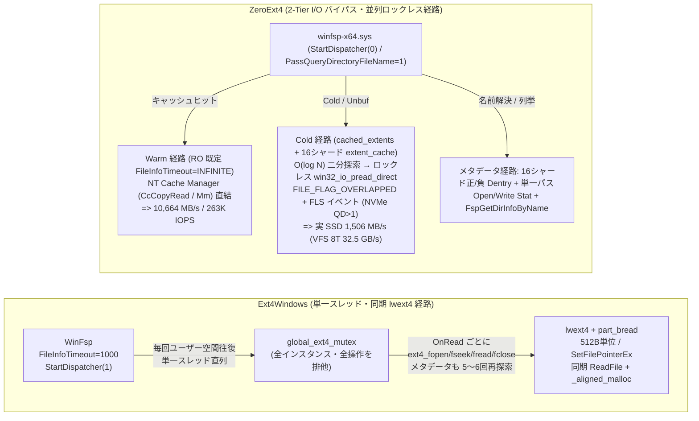

# Ext4Windows との技術比較分析

本書は、同じく **WinFsp** を用いて Windows 上に ext4 ファイルシステムをマウントする OSS 実装である **[Ext4Windows](https://github.com/Mateuscruz19/Ext4Windows)**（解析対象: `v1.3.0` / commit `31b83e2`）と **`ZeroExt4`**（`v0.10.0` / `e2fsprogs 1.47.4`）のソースコードを直接比較し、両者の設計思想・得意領域の違いおよび **`ZeroExt4` が Read-Only / 非破壊 `--overlay` 構成において高い性能を発揮する技術的根拠** を整理した解析レポートである。

両プロジェクトは共通して `WinFsp` 上で動作しつつも、設計の主軸が異なる。`Ext4Windows` が `lwext4` のジャーナル再生・トランザクション書込や親ディレクトリの POSIX UID/GID/mode 継承を備えた **汎用・直接 Read-Write ユーティリティ指向** であるのに対し、`ZeroExt4` は大容量モデル・データセットの高速読取と ext4 非破壊性を最優先とした **Read-Only（および Lower 厳密 RO の `--overlay`）特化設計** を採っている。

- 解析手法: 両リポジトリの実装ソースコードの静的構造比較（`Ext4Windows`: `CMakeLists.txt`, `src/ext4_filesystem.hpp/.cpp`, `src/blockdev_partition.cpp`, `src/blockdev_file.cpp`, `src/partition_scanner.cpp`, `src/main.cpp`, `src/server.cpp`, `src/gui/gui_main.cpp` vs `ZeroExt4`: [winfsp_driver.c](../../src/driver/winfsp_driver.c), [win32_io.c](../../src/io/win32_io.c), [extent_map.c](../../src/extent/extent_map.c), [op_init.c](../../src/vfs/op_init.c), [op_open.c](../../src/vfs/op_open.c), [op_read.c](../../src/vfs/op_read.c), [op_write.c](../../src/vfs/op_write.c), [op_readdir.c](../../src/vfs/op_readdir.c), [overlay_vfs.c](../../src/overlay/overlay_vfs.c)）
- `ZeroExt4` の実測ベンチマーク・トレース根拠: [性能評価レポート](performance-evaluation.md)（`v0.10.0`）および [Perfetto トレース解析・最適化レポート](perfetto-trace-analysis.md)
- 比較の前提: 本書に記載した性能数値は `ZeroExt4` の実測ベンチマーク／トレース計測値であり、`Ext4Windows` 側の特性は対象時点（`v1.3.0` / `31b83e2`）のソースコード構造に基づくアーキテクチャ分析結果です（今後のバージョンで設計変更や最適化が行われる可能性があります）。

---

## 1. 総合比較サマリー

| 比較項目 | `Ext4Windows` (`v1.3.0` / `31b83e2`) | `ZeroExt4` (`v0.10.0`) | 設計上のトレードオフ・影響 |
| :--- | :--- | :--- | :--- |
| **設計の主軸・得意領域** | **汎用・直接 RW ユーティリティ指向**（直接 RW 時の POSIX 継承・ACL・ジャーナル保護重視） | **RO / 非破壊 `--overlay` 特化**（大容量高速読取・`mmap`・非破壊性重視） | 用途に応じた設計焦点の違い（`ZeroExt4 --rw` の制約は後述） |
| **ext4 バックエンド** | `lwext4` 独自フォーク（`modern-ext4` 等を手動パッチ追加） | **本家 `e2fsprogs` `1.47.4` (`libext2fs`)**＋`compat/` Zero-Patch 分離 | 最新 ext4 機能互換・安全性・上流追従性（[ADR-0003](../adr/0003-upstream-libext2fs-over-lwext4.md)） |
| **WinFsp キャッシュ設定 (`FileInfoTimeout`)** | **常に `1000 ms` 固定** | **RO 時既定 `INFINITE` (`-1`)**（RW/Overlay 時は `1000 ms`） | Warm 読込で NT Cache Manager (`CcCopyRead` / `Mm`) が有効になりユーザー空間往復を 99.3% 削減 |
| **WinFsp ディスパッチ並列度** | **`StartDispatcher(fs_, 1)`＋単一 `global_ext4_mutex`** | **`StartDispatcher(mh->fs, 0)`（多スレッド）＋ロックレス Direct I/O** | RO / `--overlay` 時の並列読み取りが直列化されず 8 スレッドで実効スケール |
| **Cold / 物理ディスク I/O 経路** | コールバック毎の `ext4_fopen/fseek/fread/fclose`＋512B 単位・同期 `ReadFile`（`FILE_FLAG_OVERLAPPED` なし）＋都度 `_aligned_malloc`/`memcpy` | **オープンハンドル保持 `cached_extents` `O(log N)` 二分探索＋`FILE_FLAG_OVERLAPPED`＋FLS イベント再利用で最大 1 MB 一括直読** | NVMe Queue Depth > 1 を解放し、システムコール／ヒープ確保／ロック競合を排除 |
| **ブロックキャッシュ構成** | `lwext4` 内部のブロックキャッシュを利用（単一ミューテックス下） | **32 シャード（64B 整列）`SRWLOCK` Shared 参照＋CLOCK インプレース置換** | 8 スレッド並列時でもキャッシュ競合・ロック内 `malloc`/`free` ゼロ |
| **メタデータ・ディレクトリ探索** | `FillFileInfo` 内で 1 件ごとに開いて 5〜6 種の `ext4_*_get` 再探索＋`OnGetSecurityByName` で毎回 SDDL 変換、`GetDirInfoByName` 未実装 | **16 シャード正/負 Dentry キャッシュ**＋**単一パス Open/Write Stat**＋**`FspGetDirInfoByName` (`PassQueryDirectoryFileName=1`)**＋**早期 `Marker` スキップ** | Explorer 走査・`desktop.ini` 等の負のルックアップを 11.97x〜27.62x 高速化 |
| **ハンドル寿命管理** | `deferred_delete_` に蓄積し **`Unmount()` まで解放しない**（ABA / 二重 Close 回避のため） | **`UmFileContextIsUserContext2 = 1`** により `Open`/`Close` を 1:1 対応保証 | 長時間マウントでもメモリ増大せず、ハンドル単位 `cached_extents` キャッシュを安全に保持可 |
| **非破壊書き込み (`Overlay`)** | **非対応**（RO または直接 RW のみ） | **NTFS Upperdir `--overlay`**（`.wh.__ext4_lower_id` 誤流用防止・Lower 厳密 RO 維持） | デュアルブート環境や `.img` 検証で ext4 を 1 バイトも汚さず書き込み可（[ADR-0013](../adr/0013-ntfs-overlay-mount-and-lower-id-guard.md)） |
| **大文字／小文字制御** | `CaseSensitiveSearch = TRUE` 固定（常に大小文字区別） | 既定 Windows 互換（Case-Insensitive）＋ **`--case-sensitive` 切替**（Upperdir `FileCaseSensitiveInfo` 対応） | 一般 Win32 アプリ互換性と Linux 厳密パス共存（`/Foo` vs `/foo`）を両立 |
| **性能可視化・トレース** | なし（`dbg()` stderr/ログ出力のみ） | **組み込み Perfetto トレーサ (`--trace`)**（通常時ゼロオーバーヘッド） | コールバック・ロック待ち・I/O 遅延を定量的タイムラインで可視化可能 |
| **UI・GPLv2 境界・ビルド要件** | C++17 単一バイナリへ WebView2 埋め込み。**ビルド時に WinFsp SDK 必須** | **`.NET 10` WPF GUI を別プロセス疎結合**（JSON / Named Event IPC）。**WinFsp SDK 不要ビルド**（ABI 静的検査内蔵） | GPLv2 と GUI のライセンス境界を維持（[ADR-0002](../adr/0002-standalone-project-boundary.md)）し、CI / ローカルのビルド可搬性を確保 |

---

## 2. なぜ ZeroExt4 は高速なのか（アーキテクチャ・コードレベルの 5 大要因）

`Ext4Windows` は「`lwext4` のグローバル状態を守るために WinFsp をシングルスレッド＋単一ロックに抑え、コールバック内で都度 `ext4_fopen` からやり直す」堅実・単純な設計を採っている一方、`ZeroExt4` は **OS カーネルキャッシュとの協調** と **ロックレス直読・シャード化キャッシュ・単一パスメタデータ処理** を徹底している。

### 2.1 OS キャッシュ統合（`FileInfoTimeout = INFINITE` vs 固定 `1000 ms`）

- **`Ext4Windows`**: `Ext4Windows/src/ext4_filesystem.cpp`（L359）でモードに関わらず `volume_params.FileInfoTimeout = 1000;` と固定している。WinFsp の仕様上、`FileInfoTimeout` が有限値（`1000 ms`）のままだと Windows NT Cache Manager（`CcCopyRead`）による継続的なページキャッシュ共有・バイパスが有効になりにくく、繰り返し読み取りや `mmap` でもユーザー空間の `OnRead` コールバック往復が発生しやすい。
- **`ZeroExt4`**: [winfsp_driver.c](../../src/driver/winfsp_driver.c#L880-L885) にて、Read-Only マウント時は既定で `FileInfoTimeout = (UINT32)-1`（`INFINITE`）を設定し、カーネル側の Cache Manager (`Cc`) / Memory Manager (`Mm`) と直接協調させている（外部更新を追従したい特殊用途には `--file-info-timeout` で上書き可能、RW / 書込可能 `--overlay` では整合性のため `1000` を維持）。
- **定量効果**: Step 2 の A/B 比較において、`1000 ms` → `INFINITE` だけで `FspRead` コールバック呼び出し回数が `17,736` → `131` 回（**-99.3%**）へ激減し、同一 NVMe SSD 計測で Warm Seq `10,664.4 MB/s` / Warm 4KB Rnd `1,026.7 MB/s` (`262,828 IOPS`) と **Windows Native NTFS 同等以上（`1.04x〜1.06x`）** に到達している（[性能評価レポート §3.3](performance-evaluation.md#33-同一-ssd-5-方式比較から得られた技術的知見step-14-および-v0100-の効果)、[Perfetto トレース解析・最適化レポート §5.2](perfetto-trace-analysis.md#52-step-2-ro-時-fileinfotimeout--infinite-効果検証結果)）。

### 2.2 並列スレッドモデルとロック設計（単一スレッド＋単一 Mutex vs マルチスレッド＋ロックレス直読）

- **`Ext4Windows`**:
  - `Ext4Windows/src/ext4_filesystem.cpp`（L125-L129）に **プロセス全体で 1 つだけの `global_ext4_mutex()`** があり、同ファイル L406-L409 では `lwext4` のグローバル内部状態破壊を防ぐために `FspFileSystemStartDispatcher(fs_, 1)` と明示的に **ディスパッチャスレッド数を `1` に制限** している。
  - つまり、複数ドライブを同時マウントしていても、また複数アプリケーションやマルチスレッドが並列 `ReadFile` を発行しても、ユーザー空間内では **並列度 1（完全直列実行）** になる。
- **`ZeroExt4`**:
  - [winfsp_driver.c](../../src/driver/winfsp_driver.c#L1213) で `StartDispatcher(mh->fs, 0)`（WinFsp 既定のマルチスレッドディスパッチャ）を起動する。
  - Read-Only および `--overlay` 下位層の読み取り（既定 Direct Extent I/O ON）では、[op_read.c](../../src/vfs/op_read.c#L97-L125) と [extent_map.c](../../src/extent/extent_map.c#L321-L384) が開いたハンドル内の `cached_extents`（初回のみ 16 シャード `extent_cache` を参照）に対して **VFS ロック（`ctx->rwlock` / `ctx->fs_lock`）もブロックキャッシュロックも一切取得せず** `ext4_extent_pread()` → `win32_io_pread_direct()` を並列実行する。
  - その結果、VFS インプロセス 8 スレッド計測でも直列化を起こさず **`32,458.9 MB/s`（`519,342 IOPS`）** までスケールしている（[性能評価レポート §2.2](performance-evaluation.md#22-vfs-単体層インプロセス測定zeroext4_benchexeenable_direct_io0-vs-1)）。

### 2.3 Cold / 物理ディスク I/O パス（毎回 Open/Seek/Malloc 同期 I/O vs Extent 二分探索＋`OVERLAPPED` 一括直読）

Cold 状態（キャッシュ未ヒット、あるいは `FILE_FLAG_NO_BUFFERING` の物理ディスク初回読込）におけるコード差はさらに顕著である。

1. **コールバック単位のファイルオープン方式**:
   - `Ext4Windows`（`Ext4Windows/src/ext4_filesystem.cpp` L949-L969）では、WinFsp 内部スレッドの重複 `OnClose` に起因するハンドルリークを避けるため、`OnOpen` 側でハンドルを保持せず、WinFsp からの `OnRead` ごとに状態を持たず毎回 `ext4_fopen(&f, path, "rb")` → `ext4_fseek` → `ext4_fread` → `ext4_fclose` を実行するシンプルな方式を採っている。実装が明快な反面、巨大な GGUF モデル等を 1 MB や 64 KB チャンクで連続読込する際にはパス解決＋iノードオープン＋クローズのコストが呼び出しごとに発生するトレードオフがある。
   - `ZeroExt4`（[op_read.c](../../src/vfs/op_read.c#L97-L125), [extent_map.c](../../src/extent/extent_map.c#L321-L384)）は、ファイルのエクステント配列（`runs[]`）を初回読み取り時にのみ抽出して `handle->cached_extents` へ保持するため、2 回目以降の `Read` チャンクは **ソート済みエクステント配列の `O(log N)` 二分探索のみ** で即座に物理セクタオフセットへ変換し、連続エクステント範囲を一括直読する。
2. **ブロックデバイス I/O 層（同期 I/O・512B 粒度・毎回ヒープ確保 vs `FILE_FLAG_OVERLAPPED`＋FLS＋ゼロコピー）**:
   - `Ext4Windows` のパーティション経路（`Ext4Windows/src/blockdev_partition.cpp` L28, L72-L74, L102-L148）は `BLOCK_SIZE = 512` かつ `FILE_FLAG_NO_BUFFERING`（`FILE_FLAG_OVERLAPPED` **未指定**）でハンドルを開き、`part_bread` のたびに **`SetFilePointerEx` → `_aligned_malloc` → 同期 `ReadFile` → `memcpy` → `_aligned_free`** を実行している。またイメージファイル経路（`Ext4Windows/src/blockdev_file.cpp` L64-L77）も CRT の `_fseeki64` + `fread` による同期 512B 単位 I/O である。
   - Windows カーネルは `FILE_FLAG_OVERLAPPED` なしのハンドルへの I/O を `FileObject->Lock` で直列化するため NVMe の Queue Depth > 1 を活かせず、さらに `part_bread` 1 回ごとの CRT ヒープ確保／解放が負荷になる。
   - 対して `ZeroExt4` の [win32_io.c](../../src/io/win32_io.c#L729-L745) はすべてのストレージハンドルを **`FILE_FLAG_OVERLAPPED`＋`FILE_SKIP_SET_EVENT_ON_HANDLE`** で開き、FLS（`FlsAlloc`）にキャッシュしたスレッド固有イベントを再利用して非同期並列 `ReadFile` を発行する。`win32_io_pread_direct()`（[win32_io.c](../../src/io/win32_io.c#L994-L1008)）はアライン適合時にゼロコピー直読し、キャッシュ層自体も **32 シャード（64B キャッシュライン整列）＋`SRWLOCK` Shared 参照＋CLOCK インプレース置換**（ロック内 `malloc`/`free` ゼロ）で保護されている。これにより同一 NVMe SSD 上の Cold 実 SSD 読込でも **`1,506.2 MB/s`**（`WSL2 9P` 比 `9.11x`）を達成している。

### 2.4 メタデータ探索・ディレクトリ列挙（1 ファイル 6〜7 回再探索 vs Dentry キャッシュ＋単一パス Stat＋`GetDirInfoByName`）

大量ファイルを含む ML データセットや Windows Explorer でのフォルダ閲覧では、メタデータ応答速度が体感性能を左右する。

- **`Ext4Windows` のメタデータ探索コスト**:
  - `FillFileInfo(path, FileInfo)`（`Ext4Windows/src/ext4_filesystem.cpp` L502-L600）が 1 ファイルの属性取得だけで `ext4_fopen`（失敗なら `ext4_dir_open`）→ `ext4_mode_get` → `ext4_atime_get` → `ext4_mtime_get` → `ext4_ctime_get` → `ext4_crtime_get` と **同一文字列パスに対するツリー探索を 6〜7 回連続実行** している。
  - さらに `OnGetSecurityByName`（同 L616-L758）では `FillFileInfo` の後に再び `ext4_mode_get` を呼び、SDDL 文字列組み立て → `ConvertStringSecurityDescriptorToSecurityDescriptorW` → `LocalFree` を毎回実行する。`OnOpen`（同 L879-L896）も `ext4_dir_open`/`ext4_fopen` の後に `FillFileInfo` を呼ぶため二重走査になる。
  - 加えて `GetDirInfoByName` および `PassQueryDirectoryFileName` が未実装のため、単一ファイル確認でディレクトリ列挙側へフォールバックするケースがあり、`OnReadDirectory`（同 L1069-L1118）では `Marker` 到達前のスキップ後も各エントリごとに `FillFileInfo` が走る。
- **`ZeroExt4` の最適化**:
  - **16 シャード正/負 Dentry キャッシュ**（[op_init.c](../../src/vfs/op_init.c#L13-L452)）：Shared ロック参照＋CLOCK 置換＋世代エポックによる $O(1)$ 一括無効化を備え、Explorer が多発する `desktop.ini` / `.lnk` 等の負のルックアップをキャッシュヒットさせて全件走査を回避する。
  - **単一パス統合 Open/Write Stat**（[op_open.c](../../src/vfs/op_open.c#L10-L80), [op_write.c](../../src/vfs/op_write.c#L8-L95)）：`ext4_vfs_open_stat` / `ext4_vfs_write_stat` により、オープン／書込時の 1 回のロック＆iノード読込からそのまま `ext4_stat_t` を返し、二重探索を排除している。
  - **`FspGetDirInfoByName`＋早期 `Marker` スキップ**（[winfsp_driver.c](../../src/driver/winfsp_driver.c#L750-L891), [op_readdir.c](../../src/vfs/op_readdir.c#L93-L102)）：`PassQueryDirectoryFileName = 1` と `FspGetDirInfoByName` により単一ファイル検索のディレクトリ全走査フォールバックを排除し、`ext4_vfs_readdir_from` で `Marker` 到達前エントリの iノード読込をスキップしている。
  - Step 4 トレース計測では `FspGetSecurityByName` **11.97x**、`FspOpen` **27.62x**、`FspReadDirectory` **14.51x**（`ctx->rwlock (S)` 保持時間 **-91.8%**）の改善を実測済みである（[Perfetto トレース解析・最適化レポート §5.4](perfetto-trace-analysis.md#54-step-4-メタデータ経路書込最適化-効果検証結果)）。

### 2.5 ハンドル寿命管理とメモリ効率（`deferred_delete_` 解放遅延 vs `UmFileContextIsUserContext2 = 1`）

- **`Ext4Windows`**: `Ext4Windows/src/ext4_filesystem.cpp`（L774-L779, L919-L934）内のコメントにある通り、WinFsp 内部スレッドから同一コンテキストへ重複 `OnClose` が届く現象と再確保時の ABA 問題を回避するため、削除された `Ext4FileContext` を `deferred_delete_` ベクタに蓄積し **`Unmount()` まで解放しない設計** を採っている（同じ理由からファイルハンドル自体も開いたまま保持せず、毎 Read/Write で再オープンする方式になっている）。
- **`ZeroExt4`**: [winfsp_driver.c](../../src/driver/winfsp_driver.c#L893) で `UmFileContextIsUserContext2 = 1` を設定することで、WinFsp ランタイム側で `Open`/`Create` と `Close` の 1:1 対応を厳密保証させている（[ADR-0011](../adr/0011-handle-context-via-user-context2.md)）。これにより、即座のメモリ解放（ASan ＋ MSVC Debug CRT リーク 0 バイト検証済み）と、`ext4_file_handle_t.cached_extents` によるロックレス直読キャッシュの安全なハンドル紐付けの両立が可能になっている。

> [!NOTE]
> **`ZeroExt4` の `--rw` モードにおける位置づけとトレードオフ**:
> `ZeroExt4` も `--rw` による直接 Read-Write マウントに対応していますが、RO 専用の `FileInfoTimeout = INFINITE` および Direct Extent I/O（`extent_cache` 経由のロックレス直読）は整合性保護のため `--rw` では無効（`--rw --direct-io` 併用は `-EINVAL` で拒否）となっています。一方で `v0.10.0` 以降は `--rw` / 標準経路にもバッチ連続エクステント書込・`fs_lock` 外並列一括読込を導入しており、実 SSD Cold 読込 **`1,433.5 MB/s`**・VFS RW 書込最大 **`4,184.5 MB/s`**・8T 読込 **`30.2 GB/s`** まで改善しています（[性能評価レポート §2.2・§2.3](performance-evaluation.md#23-同一-nvme-ssd-5-方式比較windows-native-ntfs--zeroext4--wsl---mount---vhd)）。
> それでも Linux 側を一切変更したくない用途では `--overlay` を第一推奨とし、`--rw` は直接書込・保守用途として提供する棲み分けです。

---

## 3. 機能・安全性・メンテナンス性の差異

### 3.1 ext4 バックエンド基盤と最新仕様追従

- **`Ext4Windows`**: 組み込み・省メモリ向けの `lwext4` フォークを採用している。軽量である反面、現代的な Linux ディストリビューションの ext4（`metadata_csum_seed`、`orphan_file`、スパース拡張や Out-of-order 書込等）に対応するには `lwext4` 本体の構造体・チェックサム経路へフォークパッチを随時手動追加する必要があった（同リポジトリ `docs/modern-ext4-r8-fix-record.md` に記録）。
- **`ZeroExt4`**: 上流 **`e2fsprogs` `1.47.4` (`libext2fs`)** をそのままコアに採用し（[ADR-0003](../adr/0003-upstream-libext2fs-over-lwext4.md)）、MSVC 互換レイヤーを `compat/` とヘッダ自動生成へ隔離する **Zero-Patch 追従構成** を採っている（[ADR-0005](../adr/0005-zero-patch-e2fsprogs-compat-layer.md)）。実際 `v0.5.0` では `scripts/update_e2fsprogs.ps1` を用いて `e2fsprogs` `1.47.2` → `1.47.4` へ最小工数で追従を完了している。

### 3.2 非破壊運用と安全保護モデル

- **`ZeroExt4`（RO / 非破壊 `--overlay` 中心の安全モデル）**:
  - **非破壊 NTFS Overlay (`--overlay`)** により、Lower 側の ext4 ボリュームを `GENERIC_READ`＋Direct I/O で 1 バイトも書き換えずに維持したまま、Windows 側の設定変更やキャッシュ生成だけを NTFS フォルダへ逃がせる。`.wh.__ext4_lower_id`（＋`--case-sensitive` 時の `:cs` サフィックス）により別ボリューム／別モードへの誤流用も防止する（[ADR-0013](../adr/0013-ntfs-overlay-mount-and-lower-id-guard.md)）。
  - **多層ガード**: `win32_io` のパーティション境界クランプ、JBD2 Dirty Journal 検出時の `--rw` 自動拒否／`--ro-fallback`（Windows 上でのジャーナル再生や FS 修復は非目標とし、安全側に倒す設計。[ADR-0008](../adr/0008-dirty-journal-safety-guard.md)）、および `unmount` / GUI 残留解除時の `QueryDosDeviceW`・`GetVolumeInformationW` ターゲット所有者チェックを備える。
- **`Ext4Windows`（直接 RW 運用の実用性とプリフライト保護）**:
  - Overlay 機能はなく、読み取り専用または直接 Read-Write 方式を採る。RW マウント時には事前 RO プローブで `last_orphan` / `ORPHAN_PRESENT` と未対応 `ro_features`（`EXT4W_STATUS_UNSUPPORTED_RW_FEATURE`）を検査し、空の orphan ファイルのみフラグ消去した上で `ext4_recover()` + `ext4_journal_start()` を有効化して直接書込を行う実用的なプリフライト機構を実装している。

### 3.3 計測・ビルド可搬性・ライセンス分離

- **計測基盤**: `ZeroExt4` は `--trace` による Perfetto タイムライン計測（ロック待ち・保持・コールバック・キャッシュヒット定量化）と `zeroext4_bench.exe` を内蔵しており、本書で述べた `ZeroExt4` 側の高速化もすべて実測とボトルネック特定に基づいている。
- **ビルド可搬性**: `Ext4Windows` は `cmake/FindWinFsp.cmake` でローカルへの WinFsp SDK インストールを前提とする一方、`ZeroExt4` は [winfsp.h](../../third_party/winfsp/include/winfsp/winfsp.h) に互換 ABI 定義と `FSP_ABI_ASSERT` コンパイル時チェックを内蔵し（[ADR-0010](../adr/0010-winfsp-abi-layout-assertions.md)）、SDK 未導入環境でも C11 コアビルドおよび WinFsp コールバックのインプロセス自動テストが完結する。
- **GUI と GPLv2 境界**: `Ext4Windows` は C++ 本体（GPLv2）に WebView2 ブラウザホストを組み込む単一実行ファイル統合構成（配布の簡潔さ重視）であるのに対し、`ZeroExt4` は `.NET 10` WPF GUI (`ZeroExt4Gui.exe`) を別プロセスとして分離し、`zeroext4.exe` を JSON / Named Event IPC 経由で疎結合制御する境界を維持している（[ADR-0002](../adr/0002-standalone-project-boundary.md)）。

---

## 4. Ext4Windows の特徴・強みと用途別の使い分け

### 4.1 Ext4Windows の主な強み

`Ext4Windows` にも、デスクトップ向けの直接 RW ユーティリティとして優れた設計判断がある。

1. **直接 RW 時の POSIX メタデータ整合・権限マッピング**:
   - `Ext4Windows/src/ext4_filesystem.cpp` の `inherit_created_metadata()`（L80-L118）により、Windows から新規作成したファイル／ディレクトリへ親ディレクトリの Linux UID / GID およびアクセス権クラス（setgid ビット含む）を自動継承させるため、Linux 再起動後にすべてが `root:root` 所有になる問題を防いでいる。
   - `OnGetSecurityByName`（L651-L759）では POSIX rwx ビットと親ディレクトリの `w+x` 権限を Windows SDDL（`DELETE`, `FILE_DELETE_CHILD` 含む）へ動的に変換し、書き込み可能ディレクトリ内のリネーム・削除が ACL で弾かれないよう工夫されている。
   - また、`lwext4` ベースで `ext4_recover()` によるジャーナル再生と `ext4_journal_start()` によるトランザクション保護付き直接書き込みをサポートする点も特徴である。
2. **昇格ハンドル複製による非昇格ドライブ表示**:
   - `Ext4Windows/src/main.cpp`（L648-L740）および `Ext4Windows/src/server.cpp`（L51-L105, L365-L375）では、非管理者プロセスから短い UAC 昇格ヘルパーを起動して生パーティションの `HANDLE` だけ `DuplicateHandle` で受け取り、本体サーバーとドライブマウントを通常ユーザーセッションで維持する方式を採っている（`ZeroExt4` は Mount Manager 登録＋シェル偽装の [ADR-0009](../adr/0009-elevated-drive-letter-visibility.md) を採用）。
3. **エンドユーザー向け配布パッケージング**:
   - 8 言語対応の WebView2 GUI、トレイ常駐バックグラウンドサーバー、および Inno Setup インストーラが整備されている。

### 4.2 用途別の使い分け

| 利用シナリオ | 適したツール | 主な理由 |
| :--- | :---: | :--- |
| **巨大 AI モデル（GGUF / Safetensors）・ML データセットの高速共有 / `mmap` / 大容量読取** | **`ZeroExt4`** | `FileInfoTimeout = INFINITE` (10.7 GB/s)、`FILE_FLAG_OVERLAPPED`＋Direct Extent 直読 (1.51 GB/s)、マルチスレッド並列、Dentry キャッシュにより高いスループットと低レイテンシを発揮 |
| **デュアルブート Linux 環境や `.img` を 1 バイトも壊さず Windows アプリから設定・出力を書きたい** | **`ZeroExt4` (`--overlay`)** | Lower ext4 を厳密 RO＋Direct I/O に保ったまま NTFS 上へ差分保存でき、`.wh.__ext4_lower_id` で誤適用も防止 |
| **最新 `e2fsprogs` 互換性・サイズ上限なしの厳密解析・オフライン CLI / 性能解析 (`--trace`)** | **`ZeroExt4`** | 本家 `e2fsprogs 1.47.4` 採用、`mkfs`/`inspect`/`extents`/`ls`/`cat` オフラインコマンド、Perfetto トレース内蔵 |
| **ext4 パーティション／`.img` へ直接 RW 書込しつつ、Linux 側の親 UID/GID 継承やジャーナル付き書込、GUI インストーラを重視** | **`Ext4Windows`** | 直接 RW 時の親 UID/GID/mode 自動継承、POSIX→Windows ACL 変換、`lwext4` トランザクション／ジャーナル再生、単一インストーラ配布が標準搭載（`ZeroExt4 --rw` は Direct I/O・`INFINITE` キャッシュが効かず、Linux パーミッション維持より安全検証優先） |
